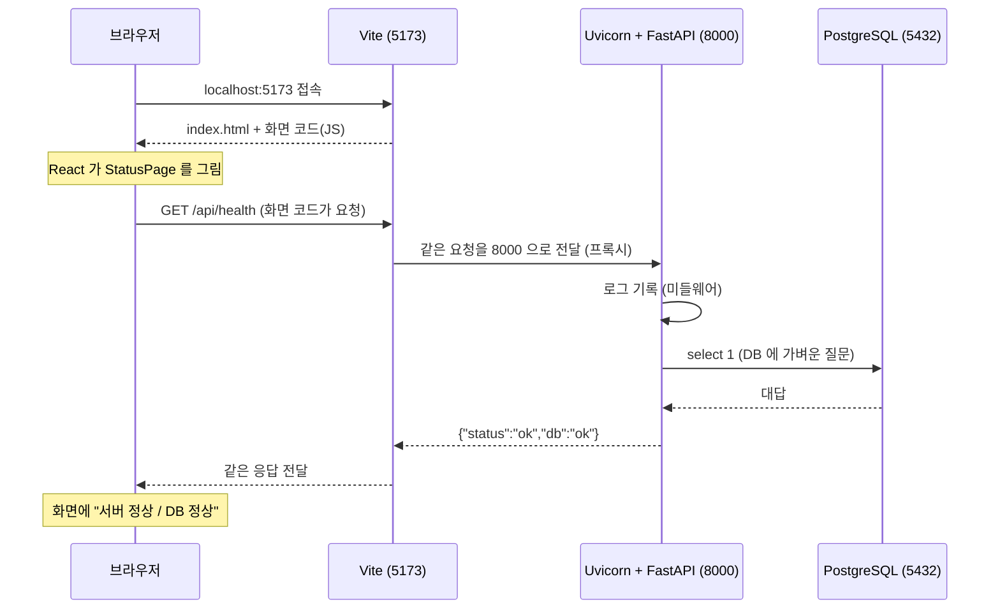

# 발표 예상 질문 모음 (기술 설명 · 요청 루트 · 질문과 답변, 슬라이스마다 누적)

**파일 위치**: `ai-agent/claude/보고서_261103_발표 예상 질문 모음 v1.0.md`
**작성일**: 2026-11-03
**버전**: v1.0 (VS-0 까지 반영, 슬라이스가 끝날 때마다 추가)
**설명**: 발표에서 설명할 수 있도록 ① 쓴 기술 ② 요청이 지나가는 길과 파일 지도 ③ 예상 질문과 답변을 한곳에 모은 문서 (CLAUDE.md 설명 의무)

> 읽는 순서: 1부(기술) → 2부(루트) → 3부(질문). 1·2부는 "무엇이 어디서 무슨 일을 하는가"의 전체 그림이다.
> 아직 쓰지 않은 기술은 `(예정)` 으로 표시했다. 슬라이스가 끝날 때마다 1·2부도 같이 늘어난다.

> 답변은 대표가 **자기 말로 바꿔 말할 수 있도록** 쉬운 말로 썼다. 외우지 말고 이유를 이해하는 것이 목표다.
> 기획·설계 단계의 질문은 각 설계 문서 끝에도 있다 (데이터 설계서 8장, 아키텍처 설계서 13장, 인터페이스 정의서 8장).

---

## 1부. 쓴 기술 설명

### 1.1 한눈에: 식당에 비유하면

| 식당 | smart-voca | 하는 일 |
|---|---|---|
| 손님이 보는 메뉴판과 테이블 | **화면** (React) | 보여주고, 입력을 받는다 |
| 홀 직원 | **서버** (FastAPI) | 주문(요청)을 받아 확인하고, 주방(DB)에 전달하고, 결과를 가져다 준다 |
| 창고 | **DB** (PostgreSQL) | 회원, 단어, 학습 기록을 보관한다 |
| 창고 정리 일지 | **Alembic** | 창고 구조(표)를 언제 어떻게 바꿨는지 기록한다 |
| 금고 열쇠 | **.env** | 비밀번호 같은 비밀을 따로 보관한다 |
| 위생 점검표 | **pytest** | 약속대로 동작하는지 자동으로 확인한다 |

핵심 원칙: **판단은 직원(서버)이 한다.** 손님(브라우저)이 말한 것을 그대로 믿지 않는다.

### 1.2 화면 쪽 기술

| 기술 | 쉬운 설명 | 왜 골랐나 | 상태 |
|---|---|---|---|
| **React** | 화면을 레고 블록(컴포넌트)처럼 쪼개서 만드는 도구. 블록 안의 값이 바뀌면 화면이 알아서 다시 그려진다 | 화면 부품을 재사용할 수 있고 널리 쓰인다 | 사용 중 |
| **Vite** | 개발 중에 화면을 바로 띄워 주는 "개발용 화면 서버". 나중에 완성본을 만드는(빌드) 도구이기도 하다 | 설정이 적고 빠르다 | 사용 중 |
| **프록시** (Vite 기능) | `/api` 로 시작하는 요청만 서버(8000)로 대신 전달해 주는 우체국 | 브라우저 입장에서 화면과 서버가 같은 주소로 보여 보안 규칙(CORS)과 쿠키 문제가 단순해진다 | 사용 중 |
| **일반 CSS + 토큰** | 색·간격 값을 변수(`tokens.css`)로 모아 두고 화면에서 가져다 쓴다. 값을 한 곳에서 바꾸면 전체가 바뀐다 | 배울 것을 줄이려고 CSS 프레임워크를 쓰지 않았다 | 사용 중 |
| **React Router** | 주소(`/login`, `/quiz`)에 따라 보여 줄 화면을 바꿔 주는 도구 | 화면이 여러 개가 되면 필요 | 설치만 함 (VS-1 부터 사용, 예정) |

### 1.3 서버 쪽 기술

| 기술 | 쉬운 설명 | 왜 골랐나 | 상태 |
|---|---|---|---|
| **Python** | 서버를 짜는 언어 | 대표님이 이미 해 본 언어 | 사용 중 |
| **FastAPI** | "이 주소로 요청이 오면 이 함수가 처리해"를 정해 두는 서버 도구. 입력 검사와 자동 문서(`/api/docs`)가 기본으로 딸려 온다 | 파이썬으로 쓰고, 입력 검사와 문서가 기본 제공되어 실수가 줄어든다 | 사용 중 |
| **Uvicorn** | FastAPI 로 만든 서버를 실제로 켜서 요청을 받게 해 주는 실행 프로그램. FastAPI 가 "요리법"이라면 Uvicorn 은 "주방 불" | FastAPI 와 함께 쓰는 표준적인 짝 | 사용 중 |
| **Pydantic** | 데이터의 모양과 타입을 검사하는 도구. 설정 읽기(`pydantic-settings`)에도 쓴다 | 잘못된 입력을 일찍 걸러 낸다 | 사용 중 (입력 검사는 VS-1 부터 본격 사용) |
| **SQLAlchemy** | 파이썬 코드로 DB 를 다루게 해 주는 번역기. 입력값을 SQL 문장에 이어 붙이지 않아 해킹(SQL 주입)을 막는다 | 직접 SQL 문자열을 만드는 것보다 안전하다 | 사용 중 (DB 연결 확인), 표 정의는 VS-1 부터 |
| **psycopg2** | 파이썬과 PostgreSQL 을 연결하는 통신 부품 | SQLAlchemy 가 PostgreSQL 과 대화하는 데 필요 | 사용 중 |
| **Alembic** | DB 표의 변경 이력 노트. 파일을 순서대로 실행하면 어떤 컴퓨터에서든 같은 DB 구조가 만들어진다 | 기능마다 표가 하나씩 늘어나는 세로 방식에 맞다 | 연결만 함 (표는 VS-1 부터) |
| **argon2-cffi** | 비밀번호를 되돌릴 수 없는 형태(해시)로 바꾸는 도구 | 비밀번호 원문을 저장하지 않으려고 | 설치·동작 확인 (VS-1 사용, 예정) |
| **PyJWT** | 로그인 증표(토큰)를 만들고 검증하는 도구 | 로그인 상태 유지 | 설치만 함 (VS-1 사용, 예정) |
| **pytest** | 테스트를 자동으로 실행해 통과/실패를 알려 주는 도구 | 핵심 로직을 자동으로 확인 | 사용 중 |
| **httpx** | 파이썬에서 다른 서버를 부르는 도구 (결제 승인 확인, 테스트에 사용) | 결제사 서버 호출 | 설치만 함 (VS-5 예정) |

### 1.4 DB 와 도구

| 기술 | 쉬운 설명 | 왜 골랐나 | 상태 |
|---|---|---|---|
| **PostgreSQL 17** | 데이터를 표(행과 열)로 보관하는 DB 프로그램 | 값 검사가 엄격해 잘못된 데이터를 DB 가 막아 주고, 시각·날짜 처리가 편하다. 대표님이 쓴 MySQL 과 SQL 기본 문법이 같다 | 사용 중 |
| **venv (가상환경)** | 이 프로젝트 전용 파이썬 공간. 다른 프로젝트와 패키지가 섞이지 않는다 | 버전 충돌 방지 | 사용 중 |
| **npm** | 화면용 패키지를 설치하는 도구 | React 생태계 표준 | 사용 중 |
| **.env / .env.example** | 비밀번호 등 설정을 담는 파일. `.env` 는 Git 이 무시하고, 값이 빈 `.env.example` 만 올린다 | 비밀이 GitHub 에 올라가는 사고 방지 | 사용 중 |
| **Git / GitHub** | 파일 변경 이력을 기록하고 원격에 보관 | 되돌리기와 백업, 집에서 이어서 작업 | 사용 중 |

## 2부. 요청이 지나가는 길 (루트)

### 2.1 가장 기본 루트: 화면이 "서버 괜찮아?"라고 물을 때 (`/health`)

번호로 풀어 쓰면:

| 순서 | 일어나는 일 | 담당 파일 |
|---|---|---|
| 1 | 브라우저가 `localhost:5173` 을 열면 Vite 가 빈 상자(`#root`)가 있는 HTML 과 화면 코드를 보내 준다 | `index.html`, `main.jsx` |
| 2 | React 가 `App` → `StatusPage` 를 그린다. 처음 나타날 때 한 번 `useEffect` 가 실행된다 | `App.jsx`, `pages/StatusPage.jsx` |
| 3 | `getHealth()` 가 `/api/health` 를 서버에 요청한다 | `api/client.js` |
| 4 | 요청은 5173 으로 가고, Vite 프록시가 8000 으로 대신 전달한다 | `vite.config.js` |
| 5 | Uvicorn 이 받아 FastAPI 로 넘기고, 모든 요청이 지나가는 검문소(미들웨어)가 "방식, 주소, 결과, 걸린 시간"을 로그로 남긴다 (본문·쿠키는 남기지 않음) | `main.py` |
| 6 | 주소 `/api/health` 담당 창구(라우터)가 일을 받고, DB 연결(세션)을 자동으로 받는다 | `routers/health.py`, `core/database.py` |
| 7 | DB 에 `select 1` 을 던져 대답이 오면 정상으로 판단한다 | PostgreSQL |
| 8 | 응답이 왔던 길로 돌아가 화면에 "정상"이 표시된다 | `StatusPage.jsx` |

### 2.2 오류 루트: 뭔가 잘못됐을 때

| 상황 | 서버가 하는 일 | 사용자에게 보이는 것 |
|---|---|---|
| 없는 주소로 요청 | `core/errors.py` 가 404 를 공통 모양으로 바꾼다 | `{"error":{"code":"NOT_FOUND","message":"..."}}` |
| 허용 안 된 방식(POST 등) | 405 를 공통 모양으로 | `METHOD_NOT_ALLOWED` |
| DB 가 고장 | `/health` 만 정해진 모양으로 503 | `{"status":"degraded","db":"error"}` |
| 예상 못 한 서버 오류 | 자세한 내용은 **로그 파일에만** 기록 | "서버에 문제가 생겼어요" 같은 일반 문장 (내부 정보 없음) |

### 2.3 서버가 켜질 때의 루트

1. `uvicorn app.main:app` 실행 → `main.py` 의 `create_app()` 호출
2. `core/config.py` 가 `.env` 를 읽어 설정을 준비 (DB 주소가 없으면 여기서 바로 멈춤)
3. `core/logging.py` 가 화면과 `logs/app.log` 로 로그를 보내도록 설정
4. `core/errors.py` 의 오류 처리기 등록
5. 라우터(`routers/health.py`)를 `/api` 아래에 등록 → 요청을 받을 준비 완료

### 2.4 파일 지도 (VS-0 기준)

**서버** (`src/backend/`)

| 파일 | 한 줄 설명 |
|---|---|
| `app/main.py` | 서버의 시작점. 로그, 오류 처리, 주소들을 한곳에 조립 |
| `app/core/config.py` | `.env` 에서 설정을 읽는다 |
| `app/core/database.py` | DB 연결 통로(엔진)와 요청마다 쓰는 연결(세션) |
| `app/core/logging.py` | 로그를 콘솔과 `logs/app.log` 에 남긴다 |
| `app/core/errors.py` | 모든 오류를 같은 모양으로 바꿔 준다 |
| `app/routers/health.py` | `GET /api/health` 담당 창구 |
| `app/models/base.py` | 앞으로 만들 DB 표들의 공통 부모 |
| `migrations/` | DB 표 변경 이력 (Alembic, 아직 비어 있음) |
| `tests/test_health.py` | 자동 테스트 4개 |
| `requirements.txt` | 설치된 패키지 목록과 버전 |

**화면** (`src/frontend/`)

| 파일 | 한 줄 설명 |
|---|---|
| `index.html` | 빈 상자(`#root`) 하나 있는 시작 페이지 |
| `src/main.jsx` | React 시작점. 빈 상자에 `App` 을 넣는다 |
| `src/App.jsx` | 화면 전체의 뼈대 |
| `src/pages/StatusPage.jsx` | 서버 상태를 보여 주는 화면 |
| `src/api/client.js` | 서버를 부르는 공통 함수와 오류 형태 |
| `vite.config.js` | 개발 서버 포트(5173)와 `/api` 프록시 설정 |
| `src/styles/tokens.css`, `app.css` | 색·간격 값, 공통 스타일 |

**프로젝트 루트**: `.env`(비밀 설정, Git 제외), `.env.example`(설정 목록표), `README.md`(실행 방법), `CLAUDE.md`(작업 지침), `ai-agent/claude/`(기획·설계 문서와 일지)

### 2.5 앞으로 추가될 루트 (슬라이스가 끝날 때 이 장에 채운다)

| 슬라이스 | 추가될 루트 |
|---|---|
| VS-1 | 회원가입 → 로그인(쿠키 발급) → 로그인 상태 확인 → 보호된 화면 |
| VS-3 | 오늘 할 것 조회 → 새 단어 카드 → "알았음" 평가 → SM-2 계산 → DB 저장 |
| VS-4 | 복습 문제 받기(정답 없음) → 힌트 요청 → 답 제출 → 채점·SM-2 반영 |
| VS-5 | 주문 생성 → 결제창 → 결제 승인 확인 → 이용권 연장 |
| VS-6 | 학습 기록 집계 → 연속 학습일·숙련도 표시 |

## 3부. 예상 질문과 답변

### VS-0 뼈대

**Q1. 로그인 같은 기능보다 서버 상태 확인부터 만든 이유는?**
기능을 먼저 만들고 나중에 연결하면, 문제가 생겼을 때 기능 버그인지 환경 문제인지 구분이 안 됩니다. 아무 기능이 없을 때 화면 → 서버 → DB가 이어지는지 먼저 확인하면 환경 문제를 일찍, 적은 비용으로 찾습니다. 실제로 이번에 "화면 서버가 IPv6 주소로만 대기해서 `127.0.0.1`로는 접속이 안 되는" 문제를 이 단계에서 찾았습니다.

**Q2. DB 비밀번호 같은 설정을 코드에 적지 않고 `.env`에 둔 이유는?**
코드는 GitHub에 올라가기 때문에 비밀번호가 코드에 있으면 그대로 공개됩니다. `.env`는 Git이 무시하도록 설정해 컴퓨터에만 두고, 코드는 그 값을 읽어서 씁니다. 대신 어떤 설정이 필요한지 알려주는 `.env.example`(값은 비워 둠)만 올립니다.

**Q3. 화면이 서버를 부를 때 왜 5173이 아니라 8000을 직접 부르지 않고 프록시를 거치나요?**
브라우저 입장에서 화면과 서버가 같은 주소(5173)로 보이게 하려는 것입니다. 주소가 다르면 브라우저가 보안상 요청을 막는 규칙(CORS)과 쿠키 문제가 생겨 설정이 복잡해집니다. 개발 서버가 `/api` 요청만 대신 서버로 넘겨주면 그 문제가 없습니다.

**Q4. 서버에 오류가 나면 사용자에게 무엇이 보이나요?**
어떤 오류든 같은 모양(`code`와 `message`)의 쉬운 문장만 보입니다. 서버 내부 오류의 자세한 내용(어느 코드에서 터졌는지 등)은 사용자에게 보내지 않고 로그 파일에만 남깁니다. 내부 정보가 화면에 나가면 공격에 악용될 수 있기 때문입니다.

**Q5. DB가 고장 난 상황은 어떻게 테스트했나요? DB를 진짜로 꺼봤나요?**
진짜로 끄지 않고, "무엇을 시켜도 오류를 내는 가짜 DB 연결"로 바꿔 끼워서 확인했습니다(의존성 교체). 그러면 컴퓨터를 건드리지 않고도 언제든 같은 상황을 반복해서 확인할 수 있습니다. 결과로 서버는 503과 함께 정해진 모양으로 "DB에 문제가 있다"고 알려줍니다.

**Q6. Python 3.14 같은 최신 버전을 써도 문제가 없었나요?**
계획한 서버 패키지(FastAPI, SQLAlchemy, DB 연결, 비밀번호 해시 등)를 모두 설치해서 실제로 불러오고 DB에 연결해 봤고 문제가 없었습니다. 시작하기 전에는 확인하지 못한 부분이었는데, 가장 먼저 검증해서 위험을 없앴습니다. 한계: 앞으로 추가하는 패키지는 그때마다 확인해야 합니다.

**Q7. 파일에 왜 자꾸 헤더(날짜, 위치, 목적)를 적나요?**
나중에 파일을 열었을 때 이게 언제 만든 어떤 목적의 파일인지 바로 알 수 있고, 팀에 넘길 때도 설명이 쉬워집니다. 프로젝트 규칙(CLAUDE.md)으로 정했습니다.

**Q8. 왜 FastAPI 를 썼나요?**
대표가 익숙한 파이썬으로 서버를 만들 수 있고, 입력 검사와 자동 문서(`/api/docs`)가 기본으로 제공되기 때문입니다. 문서가 코드에서 자동으로 만들어지니 코드와 문서가 어긋나지 않습니다.

**Q9. React 는 무엇이고 왜 썼나요?**
화면을 작은 부품(컴포넌트)으로 쪼개서 만드는 도구입니다. 부품 안의 값이 바뀌면 화면이 알아서 다시 그려져서, 학습 카드나 퀴즈처럼 화면이 자주 바뀌는 서비스에 알맞습니다. 대신 대표가 처음 쓰는 기술이라 6일 안에 배우는 부담이 있어서, 쓰는 기능을 최소한으로 줄였습니다(TypeScript, 상태관리 라이브러리, CSS 프레임워크 미사용).

**Q10. Uvicorn 과 Vite 는 둘 다 서버인데 무엇이 다른가요?**
Vite 는 화면 파일을 브라우저에 보내 주는 "화면용 개발 서버"이고(5173), Uvicorn 은 FastAPI 로 만든 "데이터 서버"를 켜 주는 프로그램입니다(8000). 브라우저는 Vite 만 바라보고, `/api` 요청만 Vite 가 Uvicorn 으로 넘겨 줍니다.
