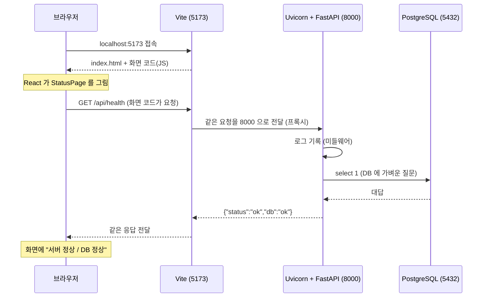

# 발표 예상 질문 모음 (기술 설명 · 요청 루트 · 질문과 답변, 슬라이스마다 누적)

**파일 위치**: `ai-agent/claude/보고서_261103_발표 예상 질문 모음 v1.0.md`
**작성일**: 2026-11-03
**버전**: v1.0 (VS-7 까지 반영, 슬라이스가 끝날 때마다 추가)
**설명**: 발표에서 설명할 수 있도록 ① 쓴 기술 ② 요청이 지나가는 길과 파일 지도 ③ 예상 질문과 답변을 한곳에 모은 문서 (CLAUDE.md 설명 의무)

> 읽는 순서: 1부(기술) → 2부(루트) → 3부(질문). 1·2부는 "무엇이 어디서 무슨 일을 하는가"의 전체 그림이다.
> 아직 쓰지 않은 기술은 `(예정)` 으로 표시했다. 슬라이스가 끝날 때마다 1·2부도 같이 늘어난다.

> 답변은 대표가 **자기 말로 바꿔 말할 수 있도록** 쉬운 말로 썼다. 외우지 말고 이유를 이해하는 것이 목표다.
> 기획·설계 단계의 질문은 각 설계 문서 끝에도 있다 (데이터 설계서 8장, 아키텍처 설계서 13장, 인터페이스 정의서 8장).

---

## 1부. 쓴 기술 설명

### 1.1 한눈에: 식당에 비유하면

| 식당 | smart-voca | 하는 일 |
|---|---|---|
| 손님이 보는 메뉴판과 테이블 | **화면** (React) | 보여주고, 입력을 받는다 |
| 홀 직원 | **서버** (FastAPI) | 주문(요청)을 받아 확인하고, 주방(DB)에 전달하고, 결과를 가져다 준다 |
| 창고 | **DB** (PostgreSQL) | 회원, 단어, 학습 기록을 보관한다 |
| 창고 정리 일지 | **Alembic** | 창고 구조(표)를 언제 어떻게 바꿨는지 기록한다 |
| 금고 열쇠 | **.env** | 비밀번호 같은 비밀을 따로 보관한다 |
| 위생 점검표 | **pytest** | 약속대로 동작하는지 자동으로 확인한다 |

핵심 원칙: **판단은 직원(서버)이 한다.** 손님(브라우저)이 말한 것을 그대로 믿지 않는다.

### 1.2 화면 쪽 기술

| 기술 | 쉬운 설명 | 왜 골랐나 | 상태 |
|---|---|---|---|
| **React** | 화면을 레고 블록(컴포넌트)처럼 쪼개서 만드는 도구. 블록 안의 값이 바뀌면 화면이 알아서 다시 그려진다 | 화면 부품을 재사용할 수 있고 널리 쓰인다 | 사용 중 |
| **Vite** | 개발 중에 화면을 바로 띄워 주는 "개발용 화면 서버". 나중에 완성본을 만드는(빌드) 도구이기도 하다 | 설정이 적고 빠르다 | 사용 중 |
| **프록시** (Vite 기능) | `/api` 로 시작하는 요청만 서버(8000)로 대신 전달해 주는 우체국 | 브라우저 입장에서 화면과 서버가 같은 주소로 보여 보안 규칙(CORS)과 쿠키 문제가 단순해진다 | 사용 중 |
| **일반 CSS + 토큰** | 색·간격 값을 변수(`tokens.css`)로 모아 두고 화면에서 가져다 쓴다. 값을 한 곳에서 바꾸면 전체가 바뀐다 | 배울 것을 줄이려고 CSS 프레임워크를 쓰지 않았다 | 사용 중 |
| **React Router** | 주소(`/login`, `/quiz`)에 따라 보여 줄 화면을 바꿔 주는 도구 | 화면이 여러 개가 되면 필요 | 사용 중 (VS-1: 로그인·가입·첫 화면 이동) |

### 1.3 서버 쪽 기술

| 기술 | 쉬운 설명 | 왜 골랐나 | 상태 |
|---|---|---|---|
| **Python** | 서버를 짜는 언어 | 대표님이 이미 해 본 언어 | 사용 중 |
| **FastAPI** | "이 주소로 요청이 오면 이 함수가 처리해"를 정해 두는 서버 도구. 입력 검사와 자동 문서(`/api/docs`)가 기본으로 딸려 온다 | 파이썬으로 쓰고, 입력 검사와 문서가 기본 제공되어 실수가 줄어든다 | 사용 중 |
| **Uvicorn** | FastAPI 로 만든 서버를 실제로 켜서 요청을 받게 해 주는 실행 프로그램. FastAPI 가 "요리법"이라면 Uvicorn 은 "주방 불" | FastAPI 와 함께 쓰는 표준적인 짝 | 사용 중 |
| **Pydantic** | 데이터의 모양과 타입을 검사하는 도구. 설정 읽기(`pydantic-settings`)에도 쓴다 | 잘못된 입력을 일찍 걸러 낸다 | 사용 중 (VS-1 가입·로그인 입력 검사, 오류 문장은 한국어로 직접 작성) |
| **SQLAlchemy** | 파이썬 코드로 DB 를 다루게 해 주는 번역기. 입력값을 SQL 문장에 이어 붙이지 않아 해킹(SQL 주입)을 막는다 | 직접 SQL 문자열을 만드는 것보다 안전하다 | 사용 중 (VS-1 에서 `users` 표 정의와 조회·저장) |
| **psycopg2** | 파이썬과 PostgreSQL 을 연결하는 통신 부품 | SQLAlchemy 가 PostgreSQL 과 대화하는 데 필요 | 사용 중 |
| **Alembic** | DB 표의 변경 이력 노트. 파일을 순서대로 실행하면 어떤 컴퓨터에서든 같은 DB 구조가 만들어진다 | 기능마다 표가 하나씩 늘어나는 세로 방식에 맞다 | 사용 중 (VS-1 에서 `users` 표 변경 파일 1개 생성·적용) |
| **argon2-cffi** | 비밀번호를 되돌릴 수 없는 형태(해시)로 바꾸는 도구 | 비밀번호 원문을 저장하지 않으려고. 일부러 느리고 메모리(약 64MB)를 써서 무차별 대입을 어렵게 한다 | 사용 중 (VS-1) |
| **PyJWT** | 로그인 증표(토큰)를 만들고 검증하는 도구 | 로그인 상태 유지 | 사용 중 (VS-1) |
| **email-validator** | 이메일 형식이 올바른지 검사하는 도구 (실제 메일을 보내 확인하지는 않음) | 잘못된 이메일 가입 방지 | 사용 중 (VS-1) |
| **pytest** | 테스트를 자동으로 실행해 통과/실패를 알려 주는 도구 | 핵심 로직을 자동으로 확인 | 사용 중 |
| **httpx** | 파이썬에서 다른 서버를 부르는 도구 (결제 승인 확인, 테스트에 사용) | 결제사 서버 호출 | 사용 중 (VS-5: 토스 승인 확인 호출, 테스트에서는 가짜로 바꿔 끼움) |
| **토스페이먼츠 결제위젯 + 승인 API** | 결제창을 화면에 띄워 주는 부품(위젯)과, 서버가 "이 결제 진짜 승인됐나요?"를 결제사에 물어보는 창구(승인 API). 테스트 키라 실제 돈은 안 나간다 | 카드 정보를 우리 서버가 직접 다루지 않아도 되고 결제 화면을 직접 만들 필요가 없다 | 사용 중 (VS-5, 테스트 키) |
| **결제 담당자(provider) 분리** | 서버가 "결제사에 확인"만 알고 결제사가 누군지는 모르게 한 칸으로 분리. 토스 담당자와 가짜 담당자가 같은 자리에 앉는다 | 테스트에 인터넷이 필요 없고, 연동이 막혀도 가짜로 대체할 수 있다(FR-SUB-08) | 사용 중 (VS-5) |

### 1.4 DB 와 도구

| 기술 | 쉬운 설명 | 왜 골랐나 | 상태 |
|---|---|---|---|
| **PostgreSQL 17** | 데이터를 표(행과 열)로 보관하는 DB 프로그램 | 값 검사가 엄격해 잘못된 데이터를 DB 가 막아 주고, 시각·날짜 처리가 편하다. 대표님이 쓴 MySQL 과 SQL 기본 문법이 같다 | 사용 중 |
| **venv (가상환경)** | 이 프로젝트 전용 파이썬 공간. 다른 프로젝트와 패키지가 섞이지 않는다 | 버전 충돌 방지 | 사용 중 |
| **npm** | 화면용 패키지를 설치하는 도구 | React 생태계 표준 | 사용 중 |
| **.env / .env.example** | 비밀번호 등 설정을 담는 파일. `.env` 는 Git 이 무시하고, 값이 빈 `.env.example` 만 올린다 | 비밀이 GitHub 에 올라가는 사고 방지 | 사용 중 |
| **CSV + 시드 스크립트** | 단어를 엑셀 같은 텍스트 표(CSV)에 적어 두고, 검사한 뒤 DB 에 넣는 프로그램 | 단어 500개를 코드가 아니라 데이터 파일로 관리하면 고치기 쉽고, 여러 번 실행해도 안전하게 만들 수 있다 | 사용 중 (VS-2) |
| **Git / GitHub** | 파일 변경 이력을 기록하고 원격에 보관 | 되돌리기와 백업, 집에서 이어서 작업 | 사용 중 |

## 2부. 요청이 지나가는 길 (루트)

### 2.1 가장 기본 루트: 화면이 "서버 괜찮아?"라고 물을 때 (`/health`)

번호로 풀어 쓰면:

| 순서 | 일어나는 일 | 담당 파일 |
|---|---|---|
| 1 | 브라우저가 `localhost:5173` 을 열면 Vite 가 빈 상자(`#root`)가 있는 HTML 과 화면 코드를 보내 준다 | `index.html`, `main.jsx` |
| 2 | React 가 `App` → `StatusPage` 를 그린다. 처음 나타날 때 한 번 `useEffect` 가 실행된다 | `App.jsx`, `pages/StatusPage.jsx` |
| 3 | `getHealth()` 가 `/api/health` 를 서버에 요청한다 | `api/client.js` |
| 4 | 요청은 5173 으로 가고, Vite 프록시가 8000 으로 대신 전달한다 | `vite.config.js` |
| 5 | Uvicorn 이 받아 FastAPI 로 넘기고, 모든 요청이 지나가는 검문소(미들웨어)가 "방식, 주소, 결과, 걸린 시간"을 로그로 남긴다 (본문·쿠키는 남기지 않음) | `main.py` |
| 6 | 주소 `/api/health` 담당 창구(라우터)가 일을 받고, DB 연결(세션)을 자동으로 받는다 | `routers/health.py`, `core/database.py` |
| 7 | DB 에 `select 1` 을 던져 대답이 오면 정상으로 판단한다 | PostgreSQL |
| 8 | 응답이 왔던 길로 돌아가 화면에 "정상"이 표시된다 | `StatusPage.jsx` |

### 2.2 오류 루트: 뭔가 잘못됐을 때

| 상황 | 서버가 하는 일 | 사용자에게 보이는 것 |
|---|---|---|
| 없는 주소로 요청 | `core/errors.py` 가 404 를 공통 모양으로 바꾼다 | `{"error":{"code":"NOT_FOUND","message":"..."}}` |
| 허용 안 된 방식(POST 등) | 405 를 공통 모양으로 | `METHOD_NOT_ALLOWED` |
| DB 가 고장 | `/health` 만 정해진 모양으로 503 | `{"status":"degraded","db":"error"}` |
| 예상 못 한 서버 오류 | 자세한 내용은 **로그 파일에만** 기록 | "서버에 문제가 생겼어요" 같은 일반 문장 (내부 정보 없음) |

### 2.3 서버가 켜질 때의 루트

1. `uvicorn app.main:app` 실행 → `main.py` 의 `create_app()` 호출
2. `core/config.py` 가 `.env` 를 읽어 설정을 준비 (DB 주소가 없으면 여기서 바로 멈춤)
3. `core/logging.py` 가 화면과 `logs/app.log` 로 로그를 보내도록 설정
4. `core/errors.py` 의 오류 처리기 등록
5. 라우터(`routers/health.py`)를 `/api` 아래에 등록 → 요청을 받을 준비 완료

### 2.4 파일 지도 (VS-1 까지)

**서버** (`src/backend/`)

| 파일 | 한 줄 설명 |
|---|---|
| `app/main.py` | 서버의 시작점. 로그, 오류 처리, 주소들을 한곳에 조립 |
| `app/core/config.py` | `.env` 에서 설정을 읽는다 |
| `app/core/database.py` | DB 연결 통로(엔진)와 요청마다 쓰는 연결(세션) |
| `app/core/logging.py` | 로그를 콘솔과 `logs/app.log` 에 남긴다 |
| `app/core/errors.py` | 모든 오류를 같은 모양으로 바꿔 준다 |
| `app/routers/health.py` | `GET /api/health` 담당 창구 |
| `app/routers/auth.py` | 회원가입·로그인·로그아웃·내 정보 4개 창구 (요청만 받고 판단은 서비스에 맡김) |
| `app/services/auth_service.py` | 업무 규칙: 이메일 중복 확인, 비밀번호 확인, 로그 기록 |
| `app/schemas/auth.py` | 입력 양식과 검사 규칙(이메일 형식, 비밀번호 8~64자·영문+숫자), 응답 양식 |
| `app/core/security.py` | 비밀번호 해시(Argon2), 로그인 증표(JWT) 만들기·검증, 쿠키 설정 |
| `app/core/dependencies.py` | "로그인한 사람만 통과" 검사 함수 `get_current_user` (보호할 API 에 붙이기만 하면 됨) |
| `app/core/timeutil.py` | 한국 시간 처리 |
| `app/models/base.py` | 앞으로 만들 DB 표들의 공통 부모 |
| `app/models/user.py` | `users` 표(회원) 설계도 |
| `migrations/versions/…_create_users.py` | `users` 표를 만드는 변경 파일 (DB 변경 이력의 첫 줄) |
| `tests/conftest.py` | 테스트 공통 준비: 테스트 전용 DB 를 처음부터 만들고 매번 비우기, 개발 DB 보호 안전장치 |
| `tests/test_health.py`, `test_security.py`, `test_auth.py` | 자동 테스트 40개 (health 4 + 해시·토큰 11 + 인증 API 25) |
| `requirements.txt` | 설치된 패키지 목록과 버전 |

**화면** (`src/frontend/`)

| 파일 | 한 줄 설명 |
|---|---|
| `index.html` | 빈 상자(`#root`) 하나 있는 시작 페이지 |
| `src/main.jsx` | React 시작점. 빈 상자에 `App` 을 넣는다 |
| `src/main.jsx` | (갱신) 주소 처리 `BrowserRouter` 와 로그인 상태 `AuthProvider` 로 앱을 감싼다 |
| `src/App.jsx` | 화면 경로 표: 주소별로 어떤 화면을 보여줄지 (`/`, `/login`, `/signup`, `/status`) |
| `src/auth/AuthContext.jsx` | 로그인 상태를 모든 화면이 함께 쓰는 "공용 게시판". 화면을 처음 열 때 서버에 "나 로그인 상태야?" 묻는다 |
| `src/api/auth.js` | 가입·로그인·로그아웃·내 정보 서버 호출 함수 |
| `src/components/ProtectedRoute.jsx` | 로그인 안 했으면 로그인 화면으로 보내는 문지기 (편의 기능, 진짜 보호는 서버) |
| `src/components/FormField.jsx` | 라벨+입력칸+오류 문구 묶음 부품 (로그인·가입 공용) |
| `src/pages/LoginPage.jsx`, `SignupPage.jsx` | 로그인·회원가입 화면 |
| `src/pages/HomePage.jsx` | 로그인 후 첫 화면 = "오늘 할 것" (VS-3 에서 교체) |
| `src/pages/NotFoundPage.jsx` | 없는 주소 안내 |
| `src/pages/StatusPage.jsx` | 서버 상태를 보여 주는 화면 (이제 `/status` 주소) |
| `src/api/client.js` | 서버를 부르는 공통 함수와 오류 형태 |
| `vite.config.js` | 개발 서버 포트(5173)와 `/api` 프록시 설정 |
| `src/styles/tokens.css`, `app.css` | 색·간격 값, 공통 스타일 |

**단어 데이터 (VS-2)**

| 파일 | 한 줄 설명 |
|---|---|
| `src/backend/app/models/word.py` | `words` 표 정의 (단어, 품사, 뜻, 예문, 번역, 학습 순서) |
| `src/backend/migrations/versions/835806a0dd82_create_words.py` | `words` 표를 만드는 변경 파일 |
| `src/backend/app/services/word_import.py` | CSV 읽기, 규칙 검사, DB 에 넣기(있으면 갱신, 없으면 추가) |
| `ai-agent/scripts/seed_words.py` | 위 기능을 실행하는 얇은 명령 도구 (`--dry-run`, `--target`) |
| `data/words/toeic_500.csv`, `README.md` | 단어 500개와 출처·선정 기준·건너뛴 단어 기록 |
| `ai-agent/uploads/TSL/` | 내려받은 TSL 원본과 출처 안내 |
| `src/frontend/src/components/SourceNotice.jsx` | 모든 화면 하단의 출처 표기 |

**새 단어 학습 + SM-2 (VS-3)**

| 파일 | 한 줄 설명 |
|---|---|
| `src/backend/app/models/user_word.py` | `user_words` 표: 회원별 단어 학습 상태(연속 성공, 간격, 난이도 계수, 다음 복습일) |
| `src/backend/app/models/review_log.py` | `review_logs` 표: 답할 때마다 쌓이는 학습 기록(추가만) |
| `src/backend/migrations/versions/8232ffda5bc4_...py` | 위 두 표를 만드는 변경 파일 |
| `src/backend/app/core_logic/sm2.py` | 복습 간격 계산 공식. DB·화면을 모르는 순수 함수라 단독 테스트 가능 |
| `src/backend/app/core_logic/quality.py` | "몰랐음/애매함/알았음" → 1/3/5점 변환표 |
| `src/backend/app/services/study_service.py` | 오늘 할 것 계산, 새 단어 뽑기, 평가 저장, 요금제 범위 검사 |
| `src/backend/app/routers/study.py`, `schemas/study.py` | `/api/study/today·new·flashcard`, `/api/me/settings` 주소와 요청/응답 양식 |
| `src/backend/tests/test_sm2.py`, `test_study.py` | SM-2 단위 테스트 16개, 학습 API 통합 테스트 40개 |
| `src/frontend/src/pages/FlashcardPage.jsx`, `SettingsPage.jsx`, `api/study.js` | 플래시카드 화면, 설정 화면, 서버 호출 함수 |

**복습 퀴즈 + 3단계 힌트 (VS-4)**

| 파일 | 한 줄 설명 |
|---|---|
| `src/backend/app/core_logic/hints.py` | 철자 섞기·빈칸 힌트 만들기. 회원+단어+날짜로 정해지는 고정 숫자(seed)를 써서 같은 날엔 같은 결과. DB·화면을 모르는 순수 함수 |
| `src/backend/app/core_logic/quality.py` | (추가) 퀴즈 결과 + 힌트 단계 → SM-2 점수 변환표 (정답 5/4/3, 오답 1, 정답 확인 2) |
| `src/backend/app/services/quiz_service.py` | 복습 대상 뽑기(오래 밀린 순), 예문 가리기, 힌트, 채점, "하루 한 번만 반영" 연습 규칙 |
| `src/backend/app/routers/quiz.py`, `schemas/quiz.py` | `/api/quiz/queue·{id}/hint·{id}/answer` 주소와 요청/응답 양식 (문제 양식에는 정답 필드 자체가 없음) |
| `src/backend/tests/test_hints.py`, `test_quiz.py` | 힌트·점수 단위 테스트 49개, 퀴즈 API 통합 테스트 29개 |
| `src/frontend/src/pages/QuizPage.jsx`, `components/HintPanel.jsx`, `api/quiz.js` | 퀴즈 화면, 힌트 패널, 서버 호출 함수 |

**구독·결제 (VS-5)**

| 파일 | 한 줄 설명 |
|---|---|
| `src/backend/app/models/payment.py` | `payments` 표: 주문번호(UNIQUE), 결제 키, 서버가 정한 금액, 이용권 일수, 상태(pending/paid/failed/canceled) |
| `src/backend/migrations/versions/2f9a077b4878_create_payments.py` | 위 표를 만드는 변경 파일 |
| `src/backend/app/core_logic/payment_rules.py` | 주문번호 만들기, 회원 키 만들기, 금액 비교, 이용권 연장 계산. DB·네트워크를 모르는 순수 함수 |
| `src/backend/app/payments/provider.py` | 결제 담당자의 공통 모양(`confirm` 하나)과 설정에 따라 담당자를 고르는 함수 |
| `src/backend/app/payments/toss_provider.py` | 토스 승인 API 호출(인증 헤더, 멱등 키, 응답 해석) |
| `src/backend/app/payments/fake_provider.py` | 가짜 담당자: 승인/거절/통신 실패를 흉내. 테스트와 비상 대체용 |
| `src/backend/app/services/subscription_service.py` | 요금제 안내, 주문 생성, 결제 확인(중복·금액·거절·통신 실패 처리), 내역 |
| `src/backend/app/routers/subscription.py`, `schemas/subscription.py` | `/api/subscription`, `/api/payments/orders·confirm`, `/api/payments` 와 양식 |
| `src/backend/tests/test_payment_rules.py`, `test_subscription.py`, `test_toss_provider.py` | 규칙 단위 10개, 구독 API 통합 26개, 토스 담당자 단위 10개 |
| `src/frontend/src/pages/SubscribePage.jsx`, `PaymentSuccessPage.jsx`, `PaymentFailPage.jsx` | 구독 화면(요금제·구매·내역), 결제 성공(서버 확인 요청), 결제 실패 안내 |
| `src/frontend/src/payments/loadToss.js`, `api/subscription.js` | 토스 위젯 스크립트를 필요할 때 불러오기, 서버 호출 함수 |

**학습 기록 (VS-6)** — 표 변경 없음(`review_logs.study_date`, `user_words.interval_days` 를 읽어 계산)

| 파일 | 한 줄 설명 |
|---|---|
| `src/backend/app/core_logic/progress_rules.py` | 연속 학습일 계산(`calculate_streak`)과 숙련도 구간(`classify_mastery`, 21일 기준). DB 를 모르는 순수 함수 |
| `src/backend/app/services/progress_service.py` | 오늘 학습량·누적·연속 학습일·숙련도 분포를 DB 에서 모아 계산 |
| `src/backend/app/routers/progress.py`, `schemas/progress.py` | `GET /api/progress/summary` 와 응답 양식 |
| `src/backend/tests/test_progress_rules.py`, `test_progress.py` | 규칙 단위 20개(경계 사례), 요약 API 통합 16개 |
| `src/frontend/src/pages/ProgressPage.jsx`, `api/progress.js` | 학습 기록 화면(`/progress`): 연속 학습일, 오늘, 전체 진행 바, 숙련도 바 |

**단어 2,000개 확장 (2026-11-05)** — 코드 변경 거의 없음(데이터 확장)

| 파일 | 한 줄 설명 |
|---|---|
| `data/words/toeic_2000.csv` | 단어 2,000개. 1~500 은 기존 그대로, 501~1231 은 TSL, 1232~2000 은 NGSL |
| `ai-agent/uploads/NGSL/NGSL_12_stats.csv`, `README.md` | NGSL 원본(2,809단어)과 출처·라이선스 안내 |
| `ai-agent/claude/261105_단어2000확장/script/` | 후보 선정(`build_candidates.py`), 묶음 검증(`check_batch.py`), 합치기(`merge_batches.py`) |
| `ai-agent/claude/261105_단어2000확장/batches/` | 100개씩 15묶음 원고, `표본검수_100.md` 는 대표 검수표 |

**VS-7 마감 (2026-11-05)** — 기능 추가 없음, 점검·도구·문서

| 파일 | 한 줄 설명 |
|---|---|
| `src/backend/tests/test_log_safety.py` | 가입·로그인·결제·서버 오류를 일으킨 뒤 로그와 오류 응답에 비밀번호·토큰·결제키·비밀값이 없는지 검사하는 테스트 3개 |
| `ai-agent/scripts/seed_demo.py` | 시연용 데모 계정과 6일 학습 이력 만들기(`demo`), 화면 확인용 임시 계정 만들기·지우기(`check-*`) |
| `ai-agent/scripts/db_backup.py` | DB 백업(`pg_dump`)과 복원(`pg_restore`). 개발 DB 덮어쓰기는 `--yes` 가 있어야 함 |
| `ai-agent/claude/운영_261105_운영·배포 정의서(Operations Guide) v1.0.md` | 처음부터 실행, 설정 키, 데모 계정, 시연 시나리오, 백업·복원, 문제 확인, 공개 배포 조건 |
| `.gitignore` | `backups/` 추가(백업 파일에 회원 정보가 들어 있어서) |
| `src/backend/migrations/versions/*.py` | 자동 생성 파일 3개에 소스 헤더(작성일·위치·목적) 추가 |

**프로젝트 루트**: `.env`(비밀 설정, Git 제외), `.env.example`(설정 목록표), `README.md`(실행 방법), `CLAUDE.md`(작업 지침), `ai-agent/claude/`(기획·설계 문서와 일지)

### 2.5 로그인 루트 (VS-1)

**① 회원가입** (화면 → 서버 → DB)

| 순서 | 일어나는 일 | 담당 파일 |
|---|---|---|
| 1 | 가입 화면에서 이메일·비밀번호를 쳐서 "가입하기" 클릭. 입력값은 `useState` 칸에 저장돼 있다 | `SignupPage.jsx` |
| 2 | `signUp()` → `POST /api/auth/signup` 요청 (프록시를 거쳐 서버로) | `AuthContext.jsx`, `api/auth.js`, `api/client.js` |
| 3 | 서버가 입력 양식을 검사한다: 이메일 형식, 비밀번호 8~64자·영문+숫자. 틀리면 여기서 422 와 한국어 메시지가 돌아가 해당 칸 아래에 표시된다 | `schemas/auth.py`, `core/errors.py` |
| 4 | 같은 이메일이 있는지 DB 에서 확인(있으면 409). 이메일은 공백을 지우고 소문자로 통일해서 비교한다 | `services/auth_service.py` |
| 5 | 비밀번호를 Argon2 로 해시해 `users` 표에 저장. 원문은 어디에도 남지 않는다 | `core/security.py`, `models/user.py` |
| 6 | 로그인 증표(JWT)를 만들어 `HttpOnly` 쿠키로 내려 준다. 가입 즉시 로그인 상태 | `routers/auth.py` |
| 7 | 화면이 응답의 회원 정보를 로그인 상태(`user`)에 넣으면 자동으로 첫 화면으로 이동 | `AuthContext.jsx`, `SignupPage.jsx` |

**② 로그인 상태 유지 (새로고침해도 로그인이 유지되는 이유)**
1. 화면이 처음 열릴 때 `AuthProvider` 가 `GET /api/auth/me` 를 부른다. 브라우저가 쿠키를 자동으로 같이 보낸다.
2. 서버의 `get_current_user` 가 쿠키의 증표를 확인한다: 서명이 맞는지, 만료되지 않았는지, 그 회원이 DB 에 있는지.
3. 통과하면 회원 정보를 돌려줘 화면이 로그인 상태가 되고, 실패하면 401 이라 화면은 비로그인 상태가 된다.
4. `ProtectedRoute` 는 비로그인이면 `/login` 으로 보낸다. 이것은 안내일 뿐이고, 진짜 막는 것은 서버의 401 이다.

**③ 로그인** : 이메일·비밀번호 → `POST /api/auth/login` → DB 에서 이메일로 회원을 찾고 입력 비밀번호를 해시와 비교 → 맞으면 쿠키 발급. 이메일이 없든 비밀번호가 틀리든 **똑같은 응답**(401, `INVALID_CREDENTIALS`)을 준다. 없는 이메일일 때도 가짜 해시를 한 번 계산해서 응답 시간 차이로도 가입 여부를 알 수 없게 했다.

**④ 로그아웃** : `POST /api/auth/logout` → 서버가 쿠키를 지우라고 응답 → 이후 `/me` 는 401. 한계: 증표 자체를 서버가 무효화하지는 않는다(Q18 참고).

### 2.6 새 단어 학습 루트 (VS-3)

| 순서 | 일어나는 일 | 담당 파일 |
|---|---|---|
| 1 | 첫 화면이 열리며 `GET /api/study/today` 호출. 서버가 "복습 대상 수(다음 복습일 ≤ 오늘)"와 "오늘 더 배울 새 단어 수"를 계산해 돌려준다. 새 단어 수 = min(하루 목표 − 오늘 배운 수, 요금제 범위 안에 남은 새 단어 수) | `HomePage.jsx`, `study_service.get_today` |
| 2 | "새 단어 배우기" → `GET /api/study/new?limit=10`. 순위가 낮은 순으로, 아직 `user_words` 행이 없는 단어(=새 단어)만, 무료는 250 이하만 뽑는다 | `FlashcardPage.jsx`, `study_service.get_new_words` |
| 3 | 카드 앞면(영단어) → "뜻 보기" → 뒷면(뜻·예문) → 몰랐음/애매함/알았음 선택 | `FlashcardPage.jsx` |
| 4 | `POST /api/study/flashcard` {word_id, rating}. 서버가 ① 단어 존재(404) ② 요금제 범위(403) ③ 이미 학습했는지(409)를 차례로 검사 | `routers/study.py`, `study_service.submit_flashcard` |
| 5 | rating → 점수(1/3/5) → SM-2 계산 → 다음 복습일 = 오늘(한국 날짜) + 간격 | `quality.py`, `sm2.py` |
| 6 | `user_words` 행 생성과 `review_logs` 행 추가를 **한 번에** 저장(둘 다 되거나 둘 다 안 됨). 같은 카드가 동시에 두 번 오면 DB 의 기본 키가 막아 409 | `study_service.py`, `models/user_word.py` |
| 7 | 하루 뒤 `today` 를 다시 부르면 다음 복습일이 오늘 이하인 단어가 "복습할 단어"로 잡힌다 (테스트에서 시계를 하루 옮겨 확인) | `test_study.py` |

### 2.7 복습 퀴즈 루트 (VS-4)

| 순서 | 일어나는 일 | 담당 파일 |
|---|---|---|
| 1 | 홈의 "복습 퀴즈 풀기" → `GET /api/quiz/queue`. 다음 복습일 ≤ 오늘인 단어를 오래 밀린 순으로 최대 10개. **응답에 정답 영단어가 없다**(뜻, 영단어를 ______ 로 가린 예문, 글자 수만) | `QuizPage.jsx`, `quiz_service.get_queue` |
| 2 | 영단어 입력 → `POST /api/quiz/{id}/answer` {answer, max_hint_level}. 서버가 대소문자·앞뒤 공백을 무시하고 비교 | `quiz_service._judge` |
| 3 | 오답이면 `wrong` 만 알려주고 정답은 숨김(`correct_answer: null`). 다시 시도하거나 힌트를 쓴다 | `quiz_service.submit_answer` |
| 4 | 힌트 `POST /api/quiz/{id}/hint` {level}: 1 철자 섞기 → 2 빈칸 → 3 정답. 서버는 저장하지 않고, 같은 날 같은 결과를 돌려준다 | `hints.py`, `HintPanel.jsx` |
| 5 | 3단계(정답 확인)를 열면 화면이 바로 `max_hint_level=3` 으로 제출 → 서버가 `revealed` 로 기록 (오답과 구분, 점수 2) | `QuizPage.handleOpenHint` |
| 6 | 오늘 이 단어의 퀴즈 기록이 없고 복습일이 도래했을 때만(첫 제출) 점수 변환 → SM-2 → `user_words` 갱신 + `review_logs` 추가를 한 번에 저장. 그 밖의 제출은 "연습"(판정만, 저장 안 함) | `quality.py`, `sm2.py`, `quiz_service.py` |

### 2.8 이용권 구매 루트 (VS-5)

| 순서 | 일어나는 일 | 담당 파일 |
|---|---|---|
| 1 | 구독 화면 `GET /api/subscription`: 요금제 두 가지와 내 만료일 | `SubscribePage.jsx`, `subscription_service.get_subscription` |
| 2 | 구매 버튼 → `POST /api/payments/orders` {product}. **금액 칸이 없다.** 서버가 주문번호(`svc-…`)·금액·일수를 정해 `payments` 에 `pending` 으로 저장 | `subscription_service.create_order`, `payment_rules.generate_order_id` |
| 3 | 화면이 결제위젯을 그리고(토스) 구매자가 결제창에서 결제. 토스는 성공하면 `/payment/success?paymentKey&orderId&amount` 로 보낸다 | `loadToss.js`, `SubscribePage.payWithToss` |
| 4 | 성공 페이지가 주소 값을 `POST /api/payments/confirm` 으로 서버에 넘긴다. **이 페이지에 왔다고 이용권이 생기지 않는다** | `PaymentSuccessPage.jsx` |
| 5 | 서버: 내 주문인가 → 이미 paid 면 같은 결과만 돌려줌 → 금액 비교 → 결제사에 승인 확인 | `confirm_payment`, `toss_provider.confirm` |
| 6 | 승인되면 **한 번에** `paid` 저장 + 이용권 연장(`max(지금, 현재 만료일)+30일`). 거절은 `failed`, 통신 실패는 `pending` 유지 | `payment_rules.extend_premium_until` |
| 7 | 이용권이 있으면 `plan_word_limit` 이 전체(단어 순위 최댓값, 현재 2000)로 열려 프리미엄 단어를 배울 수 있다. 만료되면 다시 250 | `study_service._plan_word_limit` |

### 2.9 학습 기록 루트 (VS-6)

| 순서 | 일어나는 일 | 담당 파일 |
|---|---|---|
| 1 | 홈의 "학습 기록" → `/progress` 화면이 열리며 `GET /api/progress/summary` 호출 | `ProgressPage.jsx`, `api/progress.js` |
| 2 | 서버가 "오늘"을 **한국 날짜**로 정한다 (UTC 가 아님) | `progress_service.get_summary`, `core/timeutil.py` |
| 3 | 오늘 학습량: 오늘 `review_logs` 의 서로 다른 단어 수, 그중 플래시카드(=처음 배움)인 단어 수 | `progress_service.py` |
| 4 | 누적·숙련도: `user_words` 행 수 = 배운 단어, 그중 `interval_days` ≥ 21 = 익숙함, 나머지 = 학습 중, 전체 단어 − 배운 수 = 새 단어 | `progress_service.py`, `progress_rules.py` |
| 5 | 연속 학습일: 기록이 있는 날짜 목록을 받아 오늘(오늘 아직이면 어제)부터 거꾸로 빠짐없이 이어진 날 수를 센다 | `progress_rules.calculate_streak` |
| 6 | 화면이 숫자를 퍼센트로 바꿔 진행 바 두 개(전체 진행, 숙련도)와 연속 일수를 그린다 | `ProgressPage.jsx` |

### 2.10 마감 점검과 시연 흐름 (VS-7)

**① 로그 안전 점검**

| 순서 | 일어나는 일 | 담당 파일 |
|---|---|---|
| 1 | 테스트가 가짜 브라우저로 가입 → 로그아웃 → 틀린 비밀번호 → 없는 이메일 → 로그인 → 결제 승인·거절·통신 실패를 차례로 일으킨다 | `tests/test_log_safety.py` |
| 2 | 그동안 로그 기록기가 받은 모든 문장을 모아서 "새면 안 되는 값"(비밀번호, 토큰, 결제키, JWT 비밀값, 토스 키)이 한 번이라도 있는지 찾는다. 빈 로그로 통과하는 일이 없게 "로그인 실패"·"결제 승인" 문구가 실제로 있는지도 먼저 확인한다 | 같은 파일 |
| 3 | 서버 내부 오류를 일부러 내서 응답에는 일반 문장만, 원인은 로그에만 남는지 확인한다 | `core/errors.py` 의 500 처리기 |

**② 시연 흐름** (자세한 표는 운영·배포 정의서 5.3)

| 순서 | 일어나는 일 |
|---|---|
| 1 | `seed_demo.py demo` 로 데모 계정을 초기 상태로 되돌린다(이력 6일, 오늘 복습 8개) |
| 2 | `demo@smartvoca.com` 로그인 → 오늘 할 것 → 새 단어 학습 → 복습 퀴즈(힌트) → 학습 기록(연속 6일 → 7일) |
| 3 | 프리미엄 화면에서 요금제를 보여 주고, 필요하면 토스 테스트 결제(외부 호출) 또는 가짜 결제로 이용권 구매 |
| 4 | 시연 뒤 다시 `seed_demo.py demo` 로 초기화 |

**③ 백업·복원**: `db_backup.py backup` → `backups/*.dump` 생성 → `restore --target test` 로 연습 복원 → 행 수 비교 → 개발 DB 복원은 `--yes` 필요.

## 3부. 예상 질문과 답변

### VS-0 뼈대

**Q1. 로그인 같은 기능보다 서버 상태 확인부터 만든 이유는?**
기능을 먼저 만들고 나중에 연결하면, 문제가 생겼을 때 기능 버그인지 환경 문제인지 구분이 안 됩니다. 아무 기능이 없을 때 화면 → 서버 → DB가 이어지는지 먼저 확인하면 환경 문제를 일찍, 적은 비용으로 찾습니다. 실제로 이번에 "화면 서버가 IPv6 주소로만 대기해서 `127.0.0.1`로는 접속이 안 되는" 문제를 이 단계에서 찾았습니다.

**Q2. DB 비밀번호 같은 설정을 코드에 적지 않고 `.env`에 둔 이유는?**
코드는 GitHub에 올라가기 때문에 비밀번호가 코드에 있으면 그대로 공개됩니다. `.env`는 Git이 무시하도록 설정해 컴퓨터에만 두고, 코드는 그 값을 읽어서 씁니다. 대신 어떤 설정이 필요한지 알려주는 `.env.example`(값은 비워 둠)만 올립니다.

**Q3. 화면이 서버를 부를 때 왜 5173이 아니라 8000을 직접 부르지 않고 프록시를 거치나요?**
브라우저 입장에서 화면과 서버가 같은 주소(5173)로 보이게 하려는 것입니다. 주소가 다르면 브라우저가 보안상 요청을 막는 규칙(CORS)과 쿠키 문제가 생겨 설정이 복잡해집니다. 개발 서버가 `/api` 요청만 대신 서버로 넘겨주면 그 문제가 없습니다.

**Q4. 서버에 오류가 나면 사용자에게 무엇이 보이나요?**
어떤 오류든 같은 모양(`code`와 `message`)의 쉬운 문장만 보입니다. 서버 내부 오류의 자세한 내용(어느 코드에서 터졌는지 등)은 사용자에게 보내지 않고 로그 파일에만 남깁니다. 내부 정보가 화면에 나가면 공격에 악용될 수 있기 때문입니다.

**Q5. DB가 고장 난 상황은 어떻게 테스트했나요? DB를 진짜로 꺼봤나요?**
진짜로 끄지 않고, "무엇을 시켜도 오류를 내는 가짜 DB 연결"로 바꿔 끼워서 확인했습니다(의존성 교체). 그러면 컴퓨터를 건드리지 않고도 언제든 같은 상황을 반복해서 확인할 수 있습니다. 결과로 서버는 503과 함께 정해진 모양으로 "DB에 문제가 있다"고 알려줍니다.

**Q6. Python 3.14 같은 최신 버전을 써도 문제가 없었나요?**
계획한 서버 패키지(FastAPI, SQLAlchemy, DB 연결, 비밀번호 해시 등)를 모두 설치해서 실제로 불러오고 DB에 연결해 봤고 문제가 없었습니다. 시작하기 전에는 확인하지 못한 부분이었는데, 가장 먼저 검증해서 위험을 없앴습니다. 한계: 앞으로 추가하는 패키지는 그때마다 확인해야 합니다.

**Q7. 파일에 왜 자꾸 헤더(날짜, 위치, 목적)를 적나요?**
나중에 파일을 열었을 때 이게 언제 만든 어떤 목적의 파일인지 바로 알 수 있고, 팀에 넘길 때도 설명이 쉬워집니다. 프로젝트 규칙(CLAUDE.md)으로 정했습니다.

**Q8. 왜 FastAPI 를 썼나요?**
대표가 익숙한 파이썬으로 서버를 만들 수 있고, 입력 검사와 자동 문서(`/api/docs`)가 기본으로 제공되기 때문입니다. 문서가 코드에서 자동으로 만들어지니 코드와 문서가 어긋나지 않습니다.

**Q9. React 는 무엇이고 왜 썼나요?**
화면을 작은 부품(컴포넌트)으로 쪼개서 만드는 도구입니다. 부품 안의 값이 바뀌면 화면이 알아서 다시 그려져서, 학습 카드나 퀴즈처럼 화면이 자주 바뀌는 서비스에 알맞습니다. 대신 대표가 처음 쓰는 기술이라 6일 안에 배우는 부담이 있어서, 쓰는 기능을 최소한으로 줄였습니다(TypeScript, 상태관리 라이브러리, CSS 프레임워크 미사용).

**Q10. Uvicorn 과 Vite 는 둘 다 서버인데 무엇이 다른가요?**
Vite 는 화면 파일을 브라우저에 보내 주는 "화면용 개발 서버"이고(5173), Uvicorn 은 FastAPI 로 만든 "데이터 서버"를 켜 주는 프로그램입니다(8000). 브라우저는 Vite 만 바라보고, `/api` 요청만 Vite 가 Uvicorn 으로 넘겨 줍니다.

### VS-1 계정

**Q11. 비밀번호를 왜 그대로 저장하지 않고 해시로 저장하나요?**
DB가 유출되더라도 비밀번호 원문이 노출되지 않게 하려는 것입니다. 해시는 되돌릴 수 없는 변환이라, 로그인할 때 입력한 비밀번호를 같은 방식으로 변환해 저장된 값과 비교합니다. 개발자도 회원의 비밀번호를 알 수 없습니다. 실제로 DB와 로그 파일을 검색해서 원문이 없음을 확인했습니다.

**Q12. 왜 Argon2 인가요? bcrypt 는 안 되나요?**
둘 다 비밀번호용으로 검증된 방식이고 bcrypt 도 괜찮습니다. Argon2 는 계산할 때 메모리를 많이 쓰도록 설계되어(우리 설정은 약 64MB) 그래픽카드 같은 장비로 대량 대입하기 어렵게 만든 비교적 최근 방식이어서 선택했습니다. 우리 환경(Python 3.14)에서 설치와 동작을 확인했습니다. 직접 만들지 않고 검증된 라이브러리를 쓴 것이 핵심입니다. 한계: 로그인 한 번에 메모리를 쓰기 때문에, 서비스가 커지면 서버 사양을 고려해야 합니다.

**Q13. 로그인 증표를 왜 쿠키(HttpOnly)에 담았나요? 브라우저 저장소에 넣으면 더 간단하지 않나요?**
브라우저 저장소에 넣으면 화면 코드의 자바스크립트가 읽을 수 있어서, 화면에 악성 코드가 끼어들면 증표가 털립니다. `HttpOnly` 쿠키는 자바스크립트가 읽지 못합니다. 대신 쿠키는 브라우저가 자동으로 보내기 때문에, 다른 사이트가 몰래 보내는 요청을 막아야 해서 `SameSite=Lax` 설정과 "JSON 형식만 받기"로 대응했습니다.

**Q14. 로그인에 실패했을 때 왜 "이메일이 틀렸어요/비밀번호가 틀렸어요"를 구분해 알려주지 않나요?**
구분해서 알려주면 해커가 이메일을 하나씩 넣어 보면서 "이 사람은 우리 회원이구나"를 알아낼 수 있기 때문입니다. 응답 내용뿐 아니라 응답 시간도 같게 하려고, 없는 이메일일 때도 비밀번호 계산을 한 번 해 줍니다.

**Q15. 로그인하지 않은 사람이 보호된 화면에 들어오는 것은 누가 막나요?**
화면의 `ProtectedRoute` 가 로그인 화면으로 보내 주지만, 화면 코드는 사용자가 조작할 수 있어서 진짜 보호가 아닙니다. 진짜 보호는 서버가 합니다. 로그인이 필요한 API 는 모두 쿠키의 증표를 검사하고, 위조되었거나 만료되었거나 없는 회원이면 401 로 거절합니다. 이 세 경우를 각각 자동 테스트로 확인했습니다.

**Q16. JWT 는 무엇이고 위조하면 어떻게 되나요?**
회원 번호와 만료 시각을 담고 서버의 비밀 키로 서명한 신분증입니다. 내용을 바꾸면 서명이 맞지 않아 서버가 거절합니다. 서명에는 서버만 아는 비밀 값(`JWT_SECRET`)이 쓰이므로 `.env` 에만 두고 GitHub 에 올리지 않습니다. 이메일 같은 개인정보는 담지 않습니다.

**Q17. 같은 이메일로 동시에 가입 버튼을 두 번 누르면요?**
서버가 먼저 중복을 확인하지만 그 사이에 동시에 들어오는 경우를 대비해, DB 의 이메일 UNIQUE 제약이 최후의 방어선이 됩니다. DB 가 두 번째 저장을 거부하면 서버가 "이미 가입된 이메일" 응답으로 바꿔 줍니다.

**Q18. 지금 인증 방식의 한계는 무엇인가요?**
솔직하게 세 가지입니다. ① 로그아웃은 쿠키만 지우고 증표 자체를 서버에서 무효화하지 않아서, 증표가 이미 유출됐다면 만료(7일)까지는 쓸 수 있습니다. ② 비밀번호를 계속 틀려도 막는 장치(로그인 시도 횟수 제한)가 없습니다. ③ 비밀번호 재설정과 이메일 인증이 없습니다. 이번 범위에서는 제외했고, 상용 출시 전에 추가해야 할 항목으로 정리했습니다.

### VS-2 단어 데이터

**Q19. 단어 목록은 공개 자료(TSL)에서 가져오고 뜻과 예문은 왜 직접 썼나요?**
시중 단어장의 뜻·예문은 저작권이 있어 그대로 쓸 수 없습니다. TSL 은 CC BY-SA 4.0 으로 공개된 단어 목록이라 "어떤 단어를 어떤 순서로 고를지"의 바탕으로 쓸 수 있고, 뜻·예문·번역은 우리가 새로 쓴 글이라 저작권 문제가 없습니다. 출처는 화면 하단과 `data/words/README.md` 에 표기했습니다. 한계: 뜻·예문은 AI 가 작성했고 원어민·전문가 검수를 거치지 않았습니다. 샘플 50개는 대표가 검수했고 나머지는 기계 검증만 했습니다.

**Q20. CC BY-SA 라이선스는 우리에게 어떤 의무를 주나요?**
출처를 표기해야 하고(BY), 이 자료를 바탕으로 만든 변경물은 같은 조건으로 공유해야 합니다(SA). 출처 표기는 했습니다. 다만 동일조건 공유가 우리 단어 데이터와 서비스에 정확히 어떤 영향을 주는지는 상용 출시 전에 확인해야 할 항목으로 남겼습니다. 발표에서도 한계로 솔직히 말합니다.

**Q21. TSL 상위 500개를 그대로 쓰지 않고 17개를 건너뛴 이유는 무엇인가요?**
계획은 "기초 기능어를 빼자"였지만 파일을 열어 보니 TSL 에는 처음부터 the, of 같은 단어가 없었습니다(기초 2,809단어에 얹는 보충 목록). 그래서 걸러 낼 것은 형식 규칙(o'clock, café 등)에 맞지 않는 단어와 학습 가치가 낮은 단어(mister, pant 등) 17개뿐이었고, 그 자리는 다음 순위로 채웠습니다. 건너뛴 단어와 이유는 전부 `data/words/README.md` 에 기록했습니다. "계획이 틀렸음을 확인하고 바로잡았다"는 점이 이 결정의 핵심입니다.

**Q22. 시드 스크립트를 여러 번 실행해도 단어가 500개로 유지되는 이유는 무엇인가요?**
단어(headword)를 기준으로 "이미 있으면 내용을 고치고, 없을 때만 새로 넣는" 방식(upsert)이기 때문입니다. 두 번째 실행에서 "추가 0, 갱신 500"으로 확인했습니다. 한 번에 반영하는 방식이라 중간에 실패하면 아무것도 바뀌지 않고, DB 에만 있는 단어가 있으면 조용히 두지 않고 오류를 냅니다(나중에 학습 기록이 단어 번호를 가리키므로 지우면 안 되기 때문). 순위를 서로 바꿀 때 생기는 UNIQUE 충돌은 임시 순위로 밀었다가 최종값을 넣어 해결했습니다.

**Q23. 예문에 영단어가 그대로 들어 있는지 왜 검사하나요?**
퀴즈에서 예문 속 단어를 `____` 로 가려서 문제를 내기 때문입니다. 예문에 `ran`, `runs` 처럼 활용된 형태만 있으면 가릴 곳을 찾지 못합니다. 그래서 검증 규칙으로 "단어 경계 기준으로 원형이 그대로 있는지"를 검사하고, 하나라도 실패하면 적재하지 않습니다. `sign` 이 `design` 안에서 잘못 잡히지 않는지도 테스트했습니다.

**Q24. 무료와 프리미엄 단어는 어떻게 나누나요?**
표에 무료/프리미엄 칸을 두지 않고 `frequency_rank` 가 250 이하면 무료로 "계산"합니다(DD-5). 기준을 바꾸고 싶으면 서버 설정 한 곳만 고치면 됩니다. 적재 후 무료 250개(rank 250=homework), 프리미엄 250개(rank 251=memorandum)로 확인했습니다.

### VS-3 새 단어 학습 + SM-2

**Q25. SM-2 가 무엇이고, "알았음"을 누르면 다음 복습일이 왜 늘어나나요?**
SM-2 는 "기억이 흐려질 즈음 다시 보여 주는" 복습 간격 공식입니다. 성공하면 간격이 1일 → 6일 → (이전 간격 × 난이도 계수)로 늘어나고, 실패하면 1일부터 다시 시작합니다. 잘 외운 단어는 덜 자주 보여 줘서 공부량이 줄어듭니다. 계산은 `core_logic/sm2.py` 의 순수 함수 하나이고, 단위 테스트 16개가 첫 간격 1일, 두 번째 6일, 실패 시 초기화, 난이도 계수 하한 1.30 을 확인합니다.

**Q26. "몰랐음/애매함/알았음"은 어떻게 점수가 되나요? 왜 1/3/5인가요?**
SM-2 는 0~5점을 받는데 3점부터 "기억했다"입니다. 몰랐음=1(실패), 애매함=3(간신히 성공), 알았음=5(완벽)로 매핑했습니다. 변환표는 `quality.py` 한 곳에 있어서 규칙을 바꾸기 쉽습니다. 그때 쓴 점수를 `review_logs.sm2_quality` 에 같이 저장해서, 규칙을 바꿔도 과거 계산을 확인할 수 있습니다. 4점(힌트 후 정답 등)은 VS-4 퀴즈에서 쓰입니다.

**Q27. "새 단어 목록"은 어디에 저장하나요?**
저장하지 않습니다. `user_words` 에 행이 없는 단어가 곧 새 단어입니다(DD-3). 따로 목록을 두면 학습 상태와 어긋날 수 있는데, 이렇게 하면 평가하는 순간 행이 생기며 자동으로 새 단어에서 빠집니다. 단어가 500개라 매번 계산해도 부담이 없습니다.

**Q28. 무료 범위(250개)를 화면이 아니라 서버에서 막는 이유는?**
화면 코드는 사용자가 조작할 수 있기 때문입니다. 서버가 `frequency_rank ≤ 250` 을 목록 뽑을 때(`/study/new`)와 평가 저장 때(`/study/flashcard`) 모두 검사합니다. 일부러 251번 단어 id 를 직접 보내도 403(`PLAN_LIMIT_EXCEEDED`)이 나고 DB 에는 아무것도 남지 않습니다. 프리미엄이면 같은 요청이 통과하는 것도 테스트합니다.

**Q29. 같은 카드를 두 번 평가하면 어떻게 되나요? (409)**
두 번째 요청은 409(`WORD_ALREADY_LEARNED`)로 거절되고 첫 평가 결과가 유지됩니다. 새로고침이나 더블클릭으로 중복이 와도 점수가 두 번 반영되지 않습니다. 화면은 409 를 성공처럼 다루고 다음 카드로 넘어갑니다. 서버는 먼저 확인하고, 동시에 두 요청이 와도 DB 의 기본 키(회원+단어)가 최후에 막습니다.

**Q30. `user_words` 저장과 `review_logs` 추가를 왜 한 번에 하나요?**
둘 중 하나만 저장되면 "상태는 바뀌었는데 기록이 없는" 어긋남이 생기기 때문입니다. 한 번의 저장(트랜잭션)으로 묶어서 둘 다 되거나 둘 다 안 되게 했습니다.

**Q31. 하루 새 단어 수 설정은 어떻게 반영되나요? 설정을 넘겨도 막나요?**
오늘 더 배울 수 = 설정값 − 오늘 이미 배운 수(한국 날짜 기준)입니다. 설정은 "목표치"라서 평가 API 가 막지는 않고, 새 단어 목록(`/study/new`)이 돌려주는 개수로만 조절합니다(인터페이스 정의서 4.3). 설정은 1~50 정수만 받고, 문자나 `true` 는 422 로 거절합니다.

**Q32. 테스트에서 "다음 날"은 어떻게 확인했나요?**
서비스가 시간을 `now_utc()` 한 곳에서만 읽도록 했고, 테스트가 그 함수를 하루 앞으로 옮깁니다. 그러면 실제로 하루를 기다리지 않고 "10개가 복습 대상으로 잡히고 오늘 배운 수는 0으로 초기화"를 검증할 수 있습니다.

### VS-4 복습 퀴즈 + 3단계 힌트

**Q33. 정답을 왜 브라우저에 보내지 않나요?**
브라우저로 간 데이터는 개발자도구로 누구나 볼 수 있어서, 문제 목록에 정답이 있으면 힌트 시스템이 의미가 없어집니다. 그래서 문제 목록은 뜻, 영단어를 ______ 로 가린 예문, 글자 수만 보내고, 응답 양식(`QuizItem`)에 정답 필드 자체를 두지 않았습니다. 오답일 때도 정답은 `null` 입니다. 테스트가 응답 전체 문자열에 정답이 없는지 검사합니다. (대안: 정답을 보내고 화면에서 비교 → 쉽지만 막을 수 없음)

**Q34. 힌트를 매번 같게 만든 이유는?**
요청마다 무작위로 만들면 2단계(빈칸)를 여러 번 눌러 공개 위치를 계속 바꿔 가며 정답 전체를 알아낼 수 있습니다. 그래서 "회원 id + 단어 id + 날짜 + 단계"로 고정 숫자(seed)를 만들어 같은 날엔 항상 같은 결과가 나옵니다. 날짜가 바뀌면 달라집니다. 파이썬 기본 `hash()` 는 실행마다 값이 달라서 `sha256` 을 썼습니다.

**Q35. 한 단어를 하루에 한 번만 SM-2에 반영하는 이유와 방법은?**
오답 뒤 재시도를 허용하면(FR-QUIZ-03) 같은 단어가 여러 번 제출되는데, 매번 계산하면 정답을 반복 제출해 복습 간격을 부풀릴 수 있습니다. 그래서 ① 오늘 이 단어의 퀴즈 기록이 이미 있거나 ② 복습일이 아직 안 된 단어면 판정만 하고 `practice: true` 로 처리합니다. 새 표 없이 `review_logs` 만으로 판단합니다. 한계: 첫 오답이 그날 기록으로 남습니다. 동시에 두 번 보내도 한 번만 반영되도록 `user_words` 행을 잠그고 확인합니다.

**Q36. 정답 확인(`revealed`)을 오답과 따로 기록하는 이유는?**
모르는 단어는 "틀린 것"이 아니라 "정답을 본 것"이라 감점을 덜 하고(점수 2, 오답은 1) 복습은 앞당깁니다. 따로 기록하면 나중에 힌트 사용 패턴을 분석할 수 있습니다(기획서 D-5). 3단계를 열면 입력과 상관없이 `revealed` 이고, 화면은 정답을 보여 주는 순간 바로 제출해서 "보고 나서 맞힌 것"으로 처리되지 않게 합니다.

**Q37. 힌트 3단계를 보고 `max_hint_level` 을 0으로 속여 제출할 수 있지 않나요?**
가능합니다. 하지만 본인의 복습 기록만 부정확해지는 일이라 이번 범위에서는 허용했습니다(인터페이스 정의서 알려진 위험). 서버가 힌트 열람을 기록하게 하면 막을 수 있지만 표가 늘어납니다. 출시 전 재검토 항목입니다.

**Q38. 철자 섞기에서 어떤 단어는 왜 건너뛰나요?**
글자가 3개 이하이거나 모든 글자가 같으면(aa) 섞어도 원형과 같거나 너무 쉬워서입니다. 이때 응답은 `skipped: true` 이고 화면은 안내 후 2단계로 갑니다. 공백·하이픈은 제자리에 고정하고 글자만 섞습니다. 섞은 결과가 원형과 같으면 다시 섞습니다(같은 seed 의 다음 난수로 하므로 여전히 고정 결과).

**Q39. 빈칸 힌트는 몇 글자를 보여 주나요?**
첫 글자는 항상, 전체로는 글자 수의 약 40%(반올림, 최소 1)를 공개하되 최소 한 칸은 가립니다. 공개 글자는 정답의 같은 위치 글자라 틀린 글자가 나올 수 없고, 단위 테스트가 모든 seed 에서 확인합니다.

**Q40. 힌트·퀴즈 테스트가 제대로 잡는지 어떻게 확인했나요?**
일부러 코드를 고장 내 봤습니다: 오답에도 정답 노출(1개 실패), 연습 규칙 제거(3개 실패), 힌트를 무작위로(4개 실패), `revealed` 를 `wrong` 으로(1개 실패). 각각 테스트가 실패했고 복원 후 190개가 모두 통과했습니다.

### VS-5 구독·결제

**Q41. 결제 금액을 왜 서버가 정하나요?**
브라우저가 보내는 값은 사용자가 바꿀 수 있어서입니다. 4,900원짜리를 100원으로 바꿔 보내도 통하지 않도록, 주문을 만들 때 서버가 금액을 DB 에 적어 두고 확인 요청의 금액은 비교만 합니다. 주문 요청에는 금액 칸 자체가 없고, 억지로 넣어도 무시됩니다(테스트 확인).

**Q42. 같은 결제 확인을 두 번 보내면 이용권이 두 배가 되나요?**
되지 않습니다. 이미 `paid` 인 주문은 "이미 처리됨"이라는 같은 결과만 돌려주고 결제사도 다시 부르지 않습니다(IF-6). 새로고침이나 중복 클릭에도 안전합니다. 주문 행을 잠가서 동시에 두 번 들어와도 한 번에 하나씩만 처리합니다.

**Q43. 결제 성공 페이지까지 왔으면 결제된 것 아닌가요? 왜 서버가 또 확인하나요?**
성공 페이지 주소는 누구나 직접 입력해 열 수 있어서, 주소만으로는 돈이 실제로 승인됐는지 알 수 없습니다. 서버가 결제사에 직접 물어봐서 승인(`DONE`)과 금액·주문번호 일치까지 확인한 뒤에만 이용권을 줍니다(FR-SUB-03).

**Q44. 결제사와 통신이 끊기면 어떻게 되나요?**
결과를 모르는 상태라 실패로 단정하지 않고 `pending` 으로 남기고, 화면에는 "잠시 후 다시 시도"(502)를 보여 줍니다. 나중에 같은 주문으로 다시 확인할 수 있습니다. 반대로 카드사가 거절한 경우는 확실한 실패라 `failed` 로 기록하고 새 주문을 만들게 합니다.

**Q45. 왜 결제 담당자를 따로 분리했나요? 토스 코드를 바로 쓰면 안 되나요?**
토스 호출을 서비스 로직에 섞으면 테스트마다 인터넷과 키가 필요하고, 토스 연동이 막히면 결제 전체가 멈춥니다. 분리해 두면 테스트는 가짜 담당자로 빠르게 돌고, 설정 한 줄(`PAYMENT_PROVIDER=fake`)로 가짜 결제로 대체할 수 있습니다(FR-SUB-08).

**Q46. 이용권을 겹쳐 사면 어떻게 되나요? 만료되면요?**
남은 기간 뒤에 이어 붙습니다(`max(지금, 현재 만료일)+30일`). 만료되면 새 단어는 무료 범위(250)로 돌아가지만, 이미 배운 단어의 복습은 계속 할 수 있습니다(IF-7).

**Q47. 자동 갱신(정기결제)은 왜 없나요?**
토스의 정기결제(빌링)는 별도 계약이 필요해 테스트 키만으로는 불가합니다. 이번에는 기간제 이용권으로 구현하고, "계약 후 확장 가능한 구조"로 설명합니다(FR-SUB-07).

**Q48. 결제 테스트가 제대로 잡는지 어떻게 확인했나요?**
일부러 서버 로직을 고장 냈습니다: 이미 paid 인 주문도 다시 처리(1개 실패), 금액 비교 제거(5개 실패), 남의 주문도 조회(1개 실패), 거절해도 실패 기록 안 함(1개 실패), 통신 실패를 실패로 단정(1개 실패). 토스 담당자도 승인 상태 검사 제거·인증 헤더 콜론 제거 각각 1개씩 실패했습니다. 복원 후 전체 통과했습니다.

### VS-6 학습 기록

**Q49. 연속 학습일은 어떻게 계산하나요? 왜 숫자를 저장하지 않고 매번 계산하나요?**
`review_logs` 에는 답할 때마다 "한국 날짜(`study_date`)"가 남습니다. 그 날짜 목록에서 오늘부터 거꾸로 하루도 빠짐없이 이어진 날을 셉니다. "연속 3일" 같은 숫자를 따로 저장하면 기록과 어긋날 수 있고(고치면 둘 다 고쳐야 함), 날짜만 있으면 언제든 다시 구할 수 있어서 저장하지 않았습니다(DD-3 와 같은 이유).

**Q50. 오늘 아직 학습을 안 했는데 연속 학습일이 0 이 되지 않나요?**
되지 않습니다. 오늘 아직 안 했어도 어제까지 이어졌다면 끊긴 것이 아니라고 봅니다(인터페이스 정의서 4.5). 아침에 들어왔더니 기록이 0 으로 보이는 억울함을 막기 위해서입니다. 어제도 안 했다면(하루를 완전히 건너뜀) 그때 0 이 됩니다. 화면은 "오늘 학습하면 연속 기록이 이어져요"라고 안내합니다.

**Q51. 왜 "한국 시간 기준 날짜"인가요? UTC 날짜를 쓰면 무슨 문제가 있나요?**
서버 시계는 UTC 인데 한국은 9시간 빠릅니다. UTC 날짜를 쓰면 한국 아침 9시 전에 한 학습이 "어제"로 기록돼 하루가 어긋납니다. 그래서 기록할 때도(`study_date`), 요약할 때도 한국 날짜를 씁니다(DD-8). 한국 자정 직전(UTC 14:59:59)과 직후(15:00:00)로 날짜가 바뀌는 것을 테스트로 확인했습니다.

**Q52. 숙련도는 어떻게 나누고, 왜 21일인가요?**
새 단어(아직 학습 안 함) / 학습 중(복습 간격 21일 미만) / 익숙함(21일 이상)입니다. 복습 간격이 3주 이상 벌어졌다는 것은 여러 번 연속 성공했다는 뜻이라 "익숙하다"고 볼 수 있습니다. **21일은 근거가 약한 임시 기준**이라 설계서에 `[설계 확정]` 으로 두고 상수 하나(`FAMILIAR_INTERVAL_DAYS`)로 바꿀 수 있게 했습니다. 숙련도를 저장하지 않고 간격에서 계산하므로, 기준을 바꿔도 데이터를 고칠 필요가 없습니다.

**Q53. "오늘 학습한 단어"와 "그중 새로 배운 단어"는 무엇이 다른가요?**
앞은 오늘 기록이 있는 서로 다른 단어 수(플래시카드·퀴즈 모두), 뒤는 오늘 처음 배운 단어(플래시카드 기록) 수입니다. 같은 단어를 오늘 플래시카드로 배우고 퀴즈도 풀었다면 학습한 단어는 1개로 셉니다. 기록 횟수가 아니라 단어 수이므로 한 단어를 여러 번 풀어도 부풀려지지 않습니다.

**Q54. 외운 단어를 나중에 틀리면 숙련도가 다시 내려가나요?**
네. 3점 미만이면 SM-2 가 간격을 1일로 되돌리므로 다시 "학습 중"이 됩니다(Q26 참고). 숙련도가 "한 번 익숙하면 영원히 익숙"이 아니라 "지금 기억 상태"를 보여 주는 것이라 의도한 동작입니다.

**Q55. 이 기능의 한계는 무엇인가요?**
① 퀴즈 "연습" 제출(오늘 이미 푼 단어)은 기록이 남지 않아 연속 학습일에 반영되지 않습니다. ② 무료 단어 250개를 다 배우고 복습할 단어도 없는 날에는 학습할 거리가 없어 연속이 끊길 수 있습니다(프리미엄 유도와 맞물리는 지점이라 정책 판단이 필요, 이번에는 그대로 둠). ③ 연속 학습일은 연속 날짜 전체를 매번 읽어 계산합니다. 데이터가 하루 최대 수십 건이라 문제없지만 사용자가 매우 많아지면 날짜별 요약 표가 필요합니다.

**Q56. 이 계산이 맞는지 어떻게 확인했나요?**
규칙을 DB 없이 단위 테스트(경계: 오늘 학습 전, 하루 건너뜀, 중간에 끊김, 같은 날 여러 번, 월·연도·윤일 경계, 한국 자정)로 20개, 요약 API 를 16개로 확인했습니다. 일부러 고장 내는 시험에서는 "오늘이 비면 어제부터 센다" 규칙 제거(3개 실패), 21일 경계 `>=` → `>`(1개 실패), 한국 날짜 대신 UTC(2개 실패), 다른 회원 기록 섞기(1개 실패) 등을 모두 잡았습니다. 한 가지는 테스트가 못 잡았는데(미래 날짜 무시 제거), 원인을 보니 테스트가 약한 것이 아니라 **필요 없는 코드**여서 그 코드를 지웠습니다.

### 단어 2,000개 확장

**Q57. 단어를 500개에서 2,000개로 늘릴 때 가장 큰 문제는 무엇이었나요?**
원본 목록입니다. 쓰던 TSL 은 1,250단어뿐이라 2,000개를 채울 수 없어서, 같은 사이트의 NGSL(2,809단어, 같은 CC BY-SA 4.0)을 추가했습니다. 둘은 겹치는 단어가 0개입니다(TSL 은 NGSL 에 얹는 보충 목록). 서버·화면 코드는 단어 수를 코드에 박아 두지 않아서(무료 범위는 설정, 프리미엄 범위는 순위 최댓값, 기록 화면의 분모는 DB 개수) 고칠 곳이 거의 없었습니다.

**Q58. 기존 500개의 순서를 바꾸지 않고 뒤에 붙인 이유는 무엇인가요?**
이미 학습한 기록(`user_words`, `review_logs`)이 단어 번호(`word_id`)로 연결돼 있어서, 순위나 번호가 바뀌면 기록이 엉뚱한 단어를 가리킵니다. 그래서 1~500 은 한 글자도 바꾸지 않았고(앞 500행 동일을 확인), 새 단어는 501~2000 으로 뒤에 이어 붙였습니다. 시드 스크립트가 단어 철자(`headword`) 기준으로 갱신해서 여러 번 실행해도 안전합니다.

**Q59. 새 단어의 학습 순서를 왜 "TSL 먼저, NGSL 나중"으로 정했나요? 빈도 지수로 섞는 게 더 공정하지 않나요?**
처음엔 두 목록을 빈도 지수(SFI)로 섞으려 했습니다. 그런데 실제로 순서를 뽑아 보니 501번부터 `say, go, know, get, like` 같은 초등 수준 단어가 먼저 나왔습니다. 프리미엄 첫 단어가 그렇다면 학습 경험이 떨어지므로, 토익 단어(TSL)를 먼저 끝내고 일반 기초 단어(NGSL)로 보강하도록 바꿨습니다. 설명도 쉽습니다("토익 단어를 다 배운 뒤 기초를 다진다"). 교훈은 선택지를 가상으로만 비교하지 말고 결과를 한 번 뽑아 봐야 한다는 것입니다.

**Q60. NGSL 에서 어떤 단어를 뽑았나요? the, be 같은 단어도 외우게 하나요?**
아닙니다. NGSL 순위대로 훑되 관사·대명사·전치사·조동사·접속사·수량사 같은 **기능어 110개는 건너뛰고** 769개를 채웠습니다(NGSL 순위 30~879). 건너뛴 목록은 파일로 남겼습니다. "상위 300개를 통째로 빼자"는 안은 300이라는 기준의 근거가 약해서 채택하지 않았습니다. 한계: `go`, `make` 같은 아주 쉬운 단어는 포함됩니다("순위대로" 원칙을 지킨 결과).

**Q61. 1,500개의 뜻과 예문을 AI 가 썼는데 품질은 어떻게 확인했나요?**
두 단계입니다. ① 기계 검증: 100개 묶음마다 형식·품사·중복·뜻 60자·번역 100자·예문 6~16단어·예문에 단어가 활용 없이 그대로 포함(퀴즈 빈칸용)을 검사하고, 후보 목록과 단어·순서가 같은지 대조했습니다. 전체 2,000행도 한 번에 통과시켰습니다. 검증이 실제로 3건(번역 속 쉼표가 열 구분으로 읽힘, 예문 단어 수 부족 2건)을 잡아 고쳤습니다. ② 사람 검수: 무작위 100개 표본을 대표가 확인합니다. 한계: 표본에 없는 1,400개는 기계 검증만 거쳤고, 원어민·전문 번역가 검수는 하지 않았습니다.

**Q62. 단어가 4배가 되면 무료와 프리미엄의 균형은 어떻게 되나요?**
무료는 그대로 250개라 비율이 50%에서 12.5%로 줄고, 프리미엄은 2,000개로 늘어납니다. 설정 한 줄(`FREE_WORD_LIMIT`)로 무료 범위를 바꿀 수 있습니다. 무료 비율을 유지하려면 500개로 올리면 되지만 이번에는 대표 결정대로 250개를 유지했습니다. 유료 전환 유도는 강해지지만 무료 체험이 상대적으로 작아져 사용자 이탈 위험이 있어, 시연 뒤에 조정할 가치가 있습니다.

### VS-7 마감

**Q63. 로그에 비밀번호나 토큰이 남지 않는다는 걸 어떻게 확인했나요?**
두 가지입니다. ① 실제 로그 파일(488줄)에서 `.env` 의 비밀값, `Bearer`, 결제키, 토큰 모양 문자열을 찾았고 0건이었습니다. ② "지금 괜찮다"로 끝내지 않으려고 자동 테스트(`test_log_safety.py`)를 만들었습니다. 가입·로그인 실패·결제 승인/거절/통신 실패를 일으킨 뒤 로그 전체에 비밀값이 있는지 찾습니다. 일부러 로그에 비밀번호를 넣고, 이메일 마스킹을 빼고, 결제키를 넣고, 500 응답에 원인을 노출해 보니 네 번 모두 테스트가 실패했습니다. 한계: 서버 라이브러리(uvicorn 등)가 스스로 남기는 로그는 이 테스트가 보지 못합니다(실제 로그 파일 검사로만 확인).

**Q64. 백업이 정말 복원되는지 해 봤나요?**
네. 개발 DB 를 `pg_dump` 로 백업(약 139KB)한 뒤 테스트 DB 에 `pg_restore` 로 복원하고, 표 5개의 행 수가 같은지(users 2, words 2000, user_words 53, review_logs 76, payments 22) 비교했습니다. 개발 DB 에 덮어쓰는 복원은 실수로 지우지 않도록 `--yes` 를 붙여야만 실행됩니다. 한계: 자동 예약 백업은 없고 수동입니다. 백업 파일에는 회원 이메일과 해시가 있어 `backups/` 를 Git 에서 제외했습니다.

**Q65. 서버가 꺼지거나 오류가 나면 사용자는 무엇을 보나요?**
화면마다 "불러오는 중…" → 성공 시 내용, 실패 시 서버가 보낸 문장 또는 "서버에 연결할 수 없어요. 잠시 후 다시 시도해 주세요."를 보여 줍니다. 서버 꺼짐과 500 응답을 흉내 내서 홈·기록·퀴즈·학습·프리미엄 5개 화면을 2번씩 확인했고, 없는 주소는 404 화면, 로그아웃 상태에서 보호 화면을 열면 로그인으로 이동합니다. 한계: 오류 화면에 "다시 시도" 버튼은 없어서 새로고침해야 합니다.

**Q66. 데모 계정은 실제 사용자 정보인가요? 왜 스크립트로 만들었나요?**
실제 정보가 아닌 시연용 가짜 계정입니다. 손으로 눌러 만들면 매번 결과가 달라지고, 시연이 끝나면 지저분해집니다. 스크립트(`seed_demo.py demo`)로 만들면 언제든 같은 상태로 되돌릴 수 있습니다(여러 번 실행해도 결과가 같음). 이력은 "어제까지 6일 연속, 오늘은 비워 둠"으로 설계해서 시연 중 새 단어를 배우면 연속 학습일이 6일에서 7일로 올라가는 모습을 보여 줄 수 있습니다.

**Q67. 단어를 2,000개로 늘렸을 때 501번 이후 단어가 화면에 제대로 나오는지는 어떻게 확인했나요?**
테스트 데이터로는 확인이 어려워서(실제 단어 2,000개와 학습 기록이 필요) 임시 확인 계정을 만들어 1~500번을 배운 상태로 채운 뒤 새 단어 화면을 열었습니다. 첫 카드가 501번 `deduct`(공제하다), 다음이 `disruption`, `electrician` 으로 순위 순서와 일치했고, 같은 확인을 2번 했습니다. 무료 계정은 1~249번을 채운 상태에서 250번 `homework` 가 마지막으로 나오고, 배우고 나면 "무료 단어 250개를 모두 배웠어요. 프리미엄이 필요해요"가 뜨며 기록 화면은 250/2000(13%)로 나왔습니다. 확인 뒤 임시 계정은 삭제했습니다. 다른 도메인 주소(`[::1]`)로 접속해 대표 계정의 로그인 상태를 건드리지 않았습니다.

**Q68. 무료 범위 250개는 적당한가요? (재검토 결과)**
실제 무료 범위를 뽑아 보니 1~250번은 vacation, client, airport, refund, deadline 같은 사무·출장 토익 핵심어입니다. 기본 하루 10개씩이면 25일 동안 쓸 수 있는데, 이용권 한 번이 30일이라 "한 달 체험 후 결제 판단"과 거의 맞습니다. 500개로 올리면 50일이라 체험이 길어져 결제할 이유가 줄어듭니다. 그래서 250 유지를 권합니다. 위험: 비율이 12.5%로 낮아 가입 직후 "이게 전부?"라는 인상을 줄 수 있습니다. 설정 한 줄(`FREE_WORD_LIMIT`)로 바꿀 수 있어 사용자 반응을 보고 조정할 수 있습니다.

**Q69. 상용화 수준까지 아직 부족한 점은 무엇인가요?**
정직하게 말하면 ① https·라이브 결제 키·가맹 계약(`COOKIE_SECURE=true`), ② 비밀번호 재설정과 이메일 인증, ③ 모바일 화면 최적화, ④ 자동 백업, ⑤ 1,400개 단어의 사람 검수, ⑥ 오류 화면의 재시도 버튼, ⑦ 서버 자동 재시작과 모니터링입니다. 이 프로젝트는 "핵심 학습·결제 흐름이 안전하고 테스트로 검증된 상태"까지이며, 공개 배포 조건은 운영·배포 정의서 9장에 정리했습니다.
