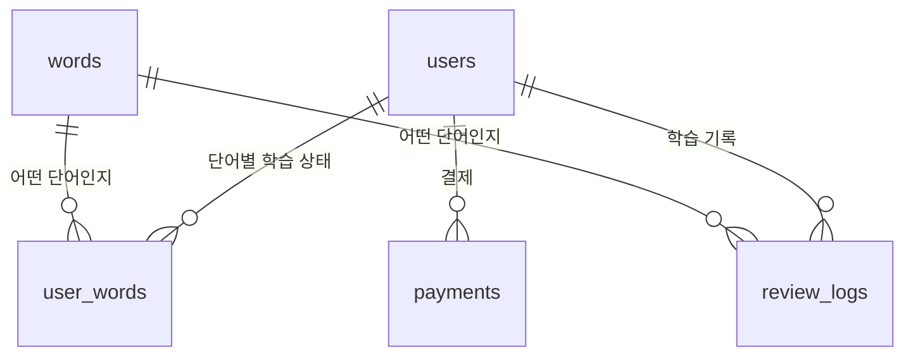

# 데이터 설계서 (Data Design)

**파일 위치**: `ai-agent/claude/설계_261103_데이터 설계서(Data Design) v1.0.md`
**작성일**: 2026-11-03
**버전**: v1.0 (초안)
**설명**: smart-voca 의 PostgreSQL 표(테이블) 구조, 컬럼, 제약 조건, 인덱스, 설계 결정을 정리한 문서

> 입력 문서: 요구사항 명세서 v1.0 (FR/NFR ID), 환경 분석서 v1.0.
> `[설계 확정]` 은 구현하면서 값을 최종 조정할 수 있는 항목, "제안"은 Claude 가 정한 임시 기본값이다.
> 이 문서에는 SQL 소스를 넣지 않는다. 실제 생성 스크립트는 구현 단계에서 이 명세를 보고 만든다.

---

## 1. 먼저 알아둘 용어 (대표 학습용)

| 용어 | 쉬운 설명 | 이 프로젝트 예시 |
|---|---|---|
| 테이블(표) | 엑셀 시트처럼 행과 열로 데이터를 넣는 단위 | `users` 표에 회원 한 명이 한 행 |
| 기본 키 (PK) | 각 행을 구분하는 번호표. 중복되면 안 됨 | `users.id` |
| 외래 키 (FK) | 다른 표의 행을 가리키는 연결 | `user_words.user_id` 가 `users.id` 를 가리킴 |
| UNIQUE | 같은 값이 두 번 들어가면 거부하는 규칙 | 같은 이메일로 두 번 가입 불가 |
| CHECK | 값의 범위를 검사하는 규칙 | 힌트 단계는 0~3 만 허용 |
| 인덱스 | 책 뒤쪽의 찾아보기. 많은 데이터에서 빨리 찾게 함 | "오늘 복습할 단어" 조회를 빠르게 |
| 트랜잭션 | 여러 변경을 "전부 성공 아니면 전부 취소"로 묶는 것 | 결제 승인 + 이용권 연장을 한 묶음으로 |

## 2. 설계 원칙

1. 요구사항(FR)에서 필요한 데이터만 만든다. 필요 없는 컬럼은 만들지 않는다.
2. 같은 정보를 두 곳에 저장하지 않는다(어긋날 위험). 계산해서 알 수 있는 값은 저장하지 않는다. (아래 DD-3, DD-5)
3. 잘못된 값은 DB 가 막는다(제약). 서버 코드가 틀려도 최후 방어선이 된다. (NFR-SEC-01)
4. 이름은 영어 소문자 snake_case, 표 이름은 복수형(`users`). 시간은 `timestamptz`(시간대 포함)를 쓴다.
5. 금액은 소수가 아닌 **원 단위 정수**로 저장한다. (소수는 계산 오차가 생길 수 있음)

## 3. 표 목록과 관계

| 표 | 역할 | 주요 FR |
|---|---|---|
| `users` | 회원 계정, 설정, 이용권 만료일 | FR-AUTH-01~07, FR-STUDY-04, FR-SUB-05 |
| `words` | 단어 2,000개 (읽기 전용 데이터, 2026-11-05 에 500에서 확장) | FR-WORD-01~06 |
| `user_words` | 사용자별 단어 학습 상태 (SM-2 값) | FR-SRS-01~05, FR-STUDY-03 |
| `review_logs` | 모든 학습·퀴즈 결과 기록 (쌓기만 함) | FR-PROG-01~05, FR-HINT-03~04 |
| `payments` | 결제 내역 | FR-SUB-02~06 |

관계 읽는 법: `users ||--o{ user_words` 는 "회원 한 명이 학습 상태 행을 여러 개 가질 수 있다"는 뜻이다. `user_words` 는 회원과 단어를 이어주는 **연결 표**로, "이 회원이 이 단어를 얼마나 아는가"를 한 행에 담는다.

## 4. 표 상세 명세

### 4.1 users (회원)

| 컬럼 | 타입 | 필수 | 설명·제약 |
|---|---|---|---|
| id | bigint, 자동 증가 | Y | PK |
| email | text | Y | 로그인 ID. 소문자로 정리해 저장, UNIQUE. FR-AUTH-01 |
| password_hash | text | Y | 비밀번호의 암호화(해시) 값. 원문은 저장하지 않음. FR-AUTH-04 |
| daily_new_limit | smallint | Y | 하루 새 단어 수 설정. 기본 10, 범위 1~50(제안) `[설계 확정]`. FR-STUDY-04 |
| premium_until | timestamptz | N | 이용권 만료 시각. 비어 있거나 과거면 무료. FR-SUB-05 |
| created_at | timestamptz | Y | 가입 시각, 기본값 현재 시각 |
| nickname | text | N | 닉네임 2~12자(길이는 서버가 검사, 중복 허용이라 UNIQUE 없음). 2026-11-06 추가, FR-PROFILE-01 |
| avatar_color | text | N | 아바타 색 6종 중 하나. CHECK `ck_users_avatar_color_allowed`. 비어 있으면 이메일로 자동 배정. FR-PROFILE-02 |
| terms_agreed_at | timestamptz | N | 필수 동의(만 14세·이용약관·개인정보)를 한 시각. 기존 회원은 비어 있음. 2026-11-06 추가, FR-CONSENT-02 |
| terms_version | text | N | 동의한 약관·방침 버전(예: `2026-11-06`). 탈퇴해도 증빙으로 남김 |
| marketing_agreed | boolean | Y | 마케팅 수신 동의(선택), 기본 false. 탈퇴 시 false |
| deleted_at | timestamptz | N | 탈퇴 시각. 값이 있으면 익명화된 탈퇴 회원(이메일 `deleted-{id}@deleted.invalid`, 해시 `!`). 로그인 증표가 남아 있어도 통과 불가. FR-PROFILE-05 |

- 인덱스: `email` UNIQUE (로그인 조회와 중복 가입 방지 겸용)
- 개인정보: 이메일과 닉네임(보기용)만 저장한다. 이름, 전화번호는 받지 않는다. 탈퇴하면 익명화하며, 결제 기록은 법정 보관을 위해 익명화한 회원 행에 연결된 채 남긴다(보관 기간은 정식 출시 전 확인 필요).

### 4.2 words (단어)

| 컬럼 | 타입 | 필수 | 설명·제약 |
|---|---|---|---|
| id | bigint, 자동 증가 | Y | PK |
| headword | text | Y | 영단어(소문자), UNIQUE. 공백·하이픈 포함 표현 허용. FR-HINT-05 |
| part_of_speech | text | Y | 품사 (예: n., v., adj.) |
| meaning_ko | text | Y | 한국어 뜻 |
| example_en | text | Y | 영어 예문 |
| example_ko | text | Y | 예문 한국어 번역 |
| frequency_rank | integer | Y | 빈도 순서(1 이 가장 자주 나옴), UNIQUE, 1 이상. FR-WORD-06 |

- 인덱스: `headword` UNIQUE (시드 스크립트가 중복 없이 갱신하는 기준. FR-WORD-05), `frequency_rank` UNIQUE (순서대로 새 단어를 뽑는 용도)
- 무료/프리미엄 구분 컬럼은 **두지 않는다.** `frequency_rank` 가 250 이하면 무료로 계산한다. (DD-5)

### 4.3 user_words (사용자별 단어 학습 상태)

회원이 한 번이라도 학습한 단어만 행이 생긴다. **행이 없으면 "새 단어"**다.

| 컬럼 | 타입 | 필수 | 설명·제약 |
|---|---|---|---|
| user_id | bigint | Y | FK → users.id, 회원이 삭제되면 같이 삭제 |
| word_id | bigint | Y | FK → words.id |
| repetitions | smallint | Y | 연속 성공 횟수, 기본 0, 0 이상 (SM-2) |
| interval_days | integer | Y | 현재 복습 간격(일), 기본 0, 0 이상 (SM-2) |
| ease_factor | numeric(3,2) | Y | 난이도 계수, 기본 2.50, **1.30 이상** (SM-2 규칙) |
| next_review_date | date | Y | 다음 복습 날짜 (한국 날짜 기준) |
| first_learned_at | timestamptz | Y | 처음 학습한 시각 |
| last_reviewed_at | timestamptz | Y | 마지막 학습 시각 |

- PK: (user_id, word_id) 두 컬럼 묶음. 같은 회원이 같은 단어 행을 두 개 가질 수 없다.
- 인덱스: (user_id, next_review_date). "오늘 복습할 단어 찾기"(FR-SRS-04)를 빠르게 한다.
- 숙련도 구분(FR-PROG-04): 새 단어 = 행 없음 / 학습 중 = `interval_days` 21 미만 / 익숙함 = 21 이상 (제안) `[설계 확정]`. 저장하지 않고 계산한다. (DD-3)

### 4.4 review_logs (학습 기록)

한 번 답할 때마다 행 하나가 **추가**된다. 고치거나 지우지 않는다.

| 컬럼 | 타입 | 필수 | 설명·제약 |
|---|---|---|---|
| id | bigint, 자동 증가 | Y | PK |
| user_id | bigint | Y | FK → users.id, 회원 삭제 시 같이 삭제 |
| word_id | bigint | Y | FK → words.id |
| activity_type | text | Y | `flashcard` 또는 `quiz` 만 허용 |
| result | text | Y | 아래 표의 6가지 중 하나만 허용 |
| max_hint_level | smallint | Y | 사용한 최고 힌트 단계 0~3, 기본 0. FR-HINT-04 |
| sm2_quality | smallint | Y | SM-2 에 반영한 점수 0~5. FR-SRS-03 |
| reviewed_at | timestamptz | Y | 답한 시각, 기본값 현재 시각 |
| study_date | date | Y | 학습한 날짜(한국 시간 기준). 연속 학습일 계산용 |

| 활동 | result 값 | 의미 |
|---|---|---|
| flashcard | `dont_know` / `unsure` / `know` | 플래시카드에서 고른 자기 평가. FR-STUDY-03 |
| quiz | `correct` / `wrong` / `revealed` | 정답 / 오답 / **정답 확인(힌트 3단계)**. `revealed` 는 오답과 따로 기록. 기획서 D-5, FR-HINT-03 |

- 조합 검사: flashcard 는 flashcard 값만, quiz 는 quiz 값만 허용한다.
- 인덱스: (user_id, study_date). 오늘 학습량, 연속 학습일을 빠르게 센다. (FR-PROG-02~03)
- `sm2_quality` 를 함께 저장하는 이유: 점수 변환 규칙(FR-SRS-03)을 나중에 바꿔도 "그때 어떤 점수로 계산했는지" 확인할 수 있고, 테스트가 쉽다.

### 4.5 payments (결제)

| 컬럼 | 타입 | 필수 | 설명·제약 |
|---|---|---|---|
| id | bigint, 자동 증가 | Y | PK |
| user_id | bigint | Y | FK → users.id. 이 표는 회원이 삭제돼도 지우지 않는 방향(DD-6) |
| order_id | text | Y | 주문번호. 서버가 만들며 UNIQUE. FR-SUB-06 |
| payment_key | text | N | 결제사가 준 결제 키. 있으면 UNIQUE |
| amount | integer | Y | 결제 금액(원), 0 보다 큼 |
| pass_days | smallint | Y | 이 결제로 얻는 이용권 일수 (예: 30) |
| status | text | Y | `pending` / `paid` / `failed` / `canceled` 만 허용 |
| requested_at | timestamptz | Y | 주문 생성 시각 |
| approved_at | timestamptz | N | 서버가 결제를 확인한 시각 |
| failure_code | text | N | 실패 사유 코드 (결제사 오류 코드) |

- 결제 흐름과 데이터: ① 구매 버튼 → 서버가 `pending` 행 생성(금액은 **서버가 정함**) → ② 결제위젯에서 결제 → ③ 서버가 결제사 API 로 승인 확인(주문번호·금액 일치 검사) → ④ **한 트랜잭션**으로 `status=paid` 와 `users.premium_until` 연장. FR-SUB-03
- 같은 주문번호는 한 번만 승인된다. `status` 가 이미 `paid` 면 다시 처리하지 않는다. FR-SUB-06

## 5. 데이터 흐름 예시

**퀴즈에서 힌트 2단계로 정답을 맞힌 경우**
1. `review_logs` 에 행 추가: `activity_type=quiz`, `result=correct`, `max_hint_level=2`, `sm2_quality=3`(제안), 오늘 `study_date`
2. `user_words` 의 해당 행 갱신: SM-2 계산으로 `repetitions`, `interval_days`, `ease_factor`, `next_review_date` 변경
3. 1과 2 는 **하나의 트랜잭션**으로 처리해 둘이 어긋나지 않게 한다.

**"오늘 할 것" 화면(FR-STUDY-01)**
- 복습 수 = `user_words` 중 `next_review_date <= 오늘` 인 행의 수
- 새 단어 수 = `min(daily_new_limit - 오늘 이미 배운 새 단어 수, 남은 새 단어)`, 새 단어는 `frequency_rank` 순서로, 무료 회원은 rank 250 이하까지

## 6. 설계 결정 기록 (ADR 성격)

| ID | 결정 | 배경·대안 | 결정 근거 |
|---|---|---|---|
| DD-1 | 학습 상태(`user_words`)와 학습 기록(`review_logs`)을 **두 표로 분리** | 대안: 기록만 두고 매번 계산 / 상태만 두고 기록 안 남김 | 상태는 "지금 값"이라 빨리 읽어야 하고 기록은 "이력"이라 쌓기만 한다. 역할이 다르다. 기록이 있어야 연속 학습일, 힌트 사용 분석(D-5), 점수 규칙 변경 검증이 가능 |
| DD-2 | `review_logs` 는 **추가만, 수정·삭제 없음** | 대안: 수정 가능하게 | 기록은 사실의 이력이라 바뀌면 안 됨. 단순해서 버그가 적다 |
| DD-3 | 숙련도(새/학습 중/익숙함)를 **저장하지 않고 계산** | 대안: 컬럼으로 저장 | 저장하면 `interval_days` 와 어긋날 수 있다(두 곳에 같은 정보). 데이터가 500개라 계산 비용이 거의 없다 |
| DD-4 | **세션 표를 만들지 않는다**(이어하기용) | 대안: `study_sessions` 표로 진행 위치 저장 | 답할 때마다 `user_words`, `review_logs` 가 바로 갱신되므로 다시 들어오면 "오늘 해야 할 목록"을 다시 계산하면 이어하기가 된다(FR-STUDY-05). 표가 줄어 구현이 단순. 단점: 문제 풀이 중 힌트 단계 같은 임시 상태는 새로고침하면 사라짐(허용) |
| DD-5 | 무료/프리미엄 단어 범위는 `words` 컬럼이 아니라 **`frequency_rank` ≤ 250 으로 계산** | 대안: `is_free` 컬럼 | 컬럼을 두면 순위와 어긋날 수 있고 요금제 범위를 바꿀 때 데이터를 고쳐야 한다. 기준값(250)은 설정으로 둠 |
| DD-6 | 결제 내역은 회원 삭제 시에도 **지우지 않는 방향**(FK 에서 삭제 제한) | 대안: 같이 삭제 | 결제 기록은 보존하는 쪽이 일반적이다. 이번 범위에 회원 탈퇴 기능이 없으므로 제약만 설계. 법적 보관 기간은 확인하지 않았다 `[미확인]` |
| DD-7 | 이용권은 `users.premium_until` **한 컬럼**으로 관리 | 대안: 이용권 이력 표(`passes`) | 이번 요구는 "만료일을 보여주고 만료 시 무료로 복귀"(FR-SUB-05)뿐이다. 이력은 `payments` 가 이미 가지고 있다. 이용권을 겹쳐 사면 `max(지금, 현재 만료일) + 일수`로 연장. 이력 표는 환불·복수 상품이 필요해지면 추가 |
| DD-8 | "날짜"는 **한국 시간(Asia/Seoul) 기준 `date`** 로 저장(`next_review_date`, `study_date`) | 대안: UTC 시각만 저장 | 사용자의 "하루"는 한국 자정 기준이다. UTC 로만 저장하면 한국 오전 9시 이전/이후로 날짜가 갈린다. 시각은 `timestamptz` 로 따로 저장 |
| DD-9 | 금액은 **정수(원)** | 대안: 소수 | 소수 계산 오차 방지 |

## 7. 추적 매트릭스 (요구사항 → 데이터)

| 요구사항 | 담당 표·컬럼 |
|---|---|
| FR-AUTH-01, 04 | `users.email`(UNIQUE), `users.password_hash` |
| FR-WORD-01~02, 06 | `words` 전체, `frequency_rank` |
| FR-WORD-05 | `words.headword`(UNIQUE) — 시드를 여러 번 실행해도 중복 안 됨 |
| FR-STUDY-03, FR-SRS-01~04 | `user_words` |
| FR-STUDY-04 | `users.daily_new_limit` |
| FR-STUDY-05 | DD-4 (별도 표 없음, 재계산) |
| FR-HINT-03~04 | `review_logs.result=revealed`, `max_hint_level` |
| FR-PROG-01~05 | `review_logs`, `user_words` (계산으로 도출) |
| FR-SUB-02~06 | `payments`, `users.premium_until` |
| NFR-SEC-01 | 각종 CHECK·UNIQUE·FK 제약 |
| NFR-DATA-01 | 백업·복원은 운영 문서에서 다룸 |

## 8. 발표 예상 질문과 답변

1. **왜 학습 상태와 학습 기록을 따로 저장했나요?**
   상태는 "지금 언제 다시 볼지"를 빨리 읽기 위한 값이고, 기록은 "무슨 일이 있었는지"를 쌓아두는 이력입니다. 역할이 달라서 나눴고, 기록이 있어서 연속 학습일과 힌트 사용 분석을 할 수 있습니다.
2. **정답 확인(힌트 3단계)을 오답이 아니라 따로 기록한 이유는?**
   틀린 것과 도움을 받은 것은 다르기 때문입니다. 따로 두면 나중에 복습 간격에 어떻게 반영할지 조절할 수 있고, 합치는 건 쉬워도 나누는 건 어렵습니다.
3. **금액을 왜 정수로 저장했나요?**
   소수는 계산 오차가 생길 수 있어서, 원 단위 정수로 저장하는 것이 안전합니다.
4. **결제를 브라우저 결과만 믿지 않고 서버에서 다시 확인하는 이유는?**
   브라우저 정보는 사용자가 조작할 수 있기 때문입니다. 금액도 서버가 정하고 결제사에 확인한 뒤에만 이용권을 줍니다.
5. **왜 MySQL 이 아니라 PostgreSQL 인가요?**
   기본 SQL 은 같지만 PostgreSQL 은 값 검사(CHECK, 타입)가 엄격해 데이터가 잘못 들어가는 것을 DB 가 막아줍니다. 시간대 포함 시각(`timestamptz`) 처리도 편합니다. 둘 다 상용 서비스에 쓰이므로 결정적 차이는 아니며, 이미 설치와 검증이 끝나 있었습니다.

## 9. 미결 사항

| # | 항목 | 상태 |
|---|---|---|
| 1 | 숙련도 기준 21일 | `[설계 확정]` (구현 후 조정) |
| 2 | `daily_new_limit` 범위 1~50 | `[설계 확정]` |
| 3 | 힌트 사용 시 `sm2_quality` 점수 규칙 | `[설계 확정]` (요구사항 FR-SRS-03) |
| 4 | 결제 기록 법적 보관 기간 | `[미확인]` |
| 5 | 비밀번호 해시 방식 | 아키텍처 설계서에서 결정 |
| 6 | 마이그레이션(표 변경 이력 관리) 도구 사용 여부 | 아키텍처 설계서에서 결정 |

## 10. 다음 산출물

1. 아키텍처 설계서: 서버가 위 표를 어떻게 읽고 쓰는지, React 와 API 로 어떻게 주고받는지
2. 구현 계획서: 위 표를 세로 방식 기능 순서에 맞춰 어느 시점에 만들지
