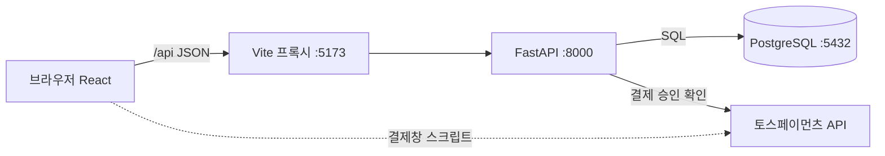
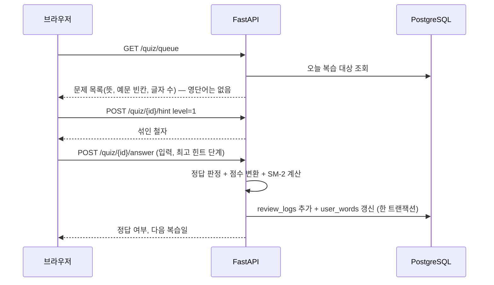
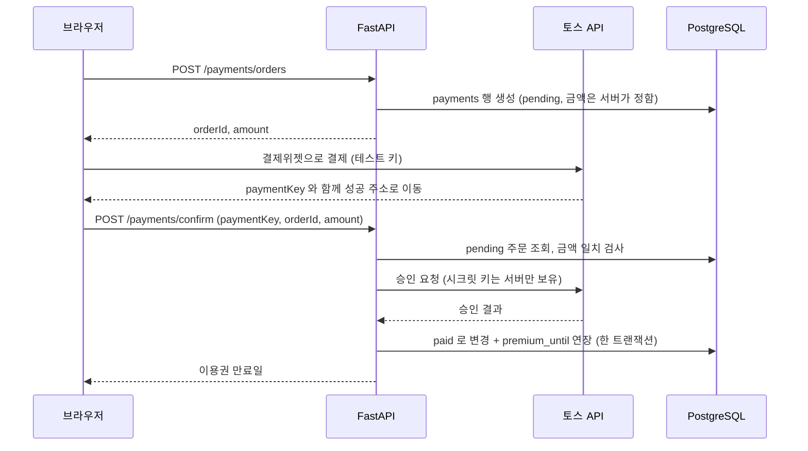

# 아키텍처 설계서 (Architecture Design)

**파일 위치**: `docs/설계_261103_아키텍처 설계서(Architecture Design) v1.0.md`
**작성일**: 2026-11-03
**버전**: v1.0 (초안)
**설명**: smart-voca 의 구성 요소, 통신 구조, 폴더 구조, 보안 전략, 기술 선택의 근거(AD-1~AD-11)를 정리한 문서

> 입력 문서: 요구사항 명세서 v1.0, 데이터 설계서 v1.0, 환경 분석서 v1.0, ADR-001(기술 스택).
> 라이브러리 **버전은 이 문서에서 고정하지 않는다.** 설치 시 현재 안정판과 Python 3.14 호환을 확인하고 `requirements.txt` / `package.json` 에 고정한다. `[설치 시 확인]` 표시 항목은 아직 확인하지 못한 사실이다.
> `[설계 확정]` 은 구현하면서 값을 최종 조정할 항목이다.

---

## 1. 전체 구성

내 노트북 한 대 안에서 프로세스 3개가 돌아간다. (인터넷 배포 없음, 기획서 D-3)

```
[ 내가 쓰는 브라우저 ]  ─ 화면(React) 실행
        │  ① 같은 주소(localhost:5173)로 요청  (/api 는 개발 서버가 대신 전달)
        ▼
[ 프론트엔드 개발 서버 (Vite) ]  :5173
        │  ② /api/... 요청을 서버로 넘김(프록시)
        ▼
[ 백엔드 서버 (FastAPI) ]  :8000 ─────③ SQL─────▶ [ PostgreSQL 17 ]  :5432
        │
        └──④ 결제 승인 확인(서버끼리)──▶ [ 토스페이먼츠 API ]  (외부, 테스트 키)

(브라우저는 결제창을 띄우기 위해 토스 결제위젯 스크립트도 직접 불러온다)
```



### 1.1 구성 요소와 책임

| 구성 요소 | 하는 일 | 하지 않는 일 |
|---|---|---|
| React 화면 | 보여주기, 입력 받기, 서버 호출 | 점수 계산, 정답 판정, 결제 금액 결정 |
| FastAPI 서버 | 로그인 확인, 정답 판정, SM-2 계산, 힌트 생성, 결제 확인 | 화면 모양 |
| PostgreSQL | 데이터 보관, 제약으로 잘못된 값 차단 | 업무 규칙 판단 |
| 토스페이먼츠 | 결제창, 결제 승인 | 우리 서비스의 이용권 판단 |

핵심 원칙: **판단은 서버가 한다.** 브라우저의 값은 사용자가 조작할 수 있기 때문이다. (NFR-SEC-01)

## 2. 서버 내부 구조 (레이어)

요청이 들어오면 위에서 아래로만 흐른다. 아래 층은 위 층을 모른다.

| 층 | 역할 | 폴더 |
|---|---|---|
| ① 라우터 (API) | 요청을 받고 응답을 돌려줌. 입력 검증. 업무 규칙은 쓰지 않음 | `routers/` |
| ② 서비스 | 업무 규칙 (학습 목록 만들기, 결제 확인, 요금제 범위) | `services/` |
| ③ 핵심 로직 | **DB 도 웹도 모르는 순수 계산** (SM-2, 힌트 생성) | `core_logic/` |
| ④ 모델 | DB 표와 1:1 대응 (SQLAlchemy) | `models/` |
| ⑤ 스키마 | 요청·응답의 모양 정의와 검증 (Pydantic) | `schemas/` |
| ⑥ 설정·공통 | 설정 읽기, 보안, 로그, 오류 처리 | `core/` |

③을 따로 두는 이유: SM-2 와 힌트 계산은 입력과 출력만 있으면 되므로 **DB 없이 테스트**할 수 있다. (FR-HINT-06, FR-SRS-06)

## 3. 폴더 구조 (CLAUDE.md 작업 공간 구조 준수)

```
smart-voca_new/
├── src/
│   ├── backend/
│   │   ├── app/
│   │   │   ├── main.py            # FastAPI 앱 생성, 라우터 등록, 오류 처리 등록
│   │   │   ├── core/              # config.py(설정), database.py(DB 연결·세션), security.py(해시·토큰·쿠키), dependencies.py(로그인 검사), timeutil.py(한국 시간), logging.py, errors.py
│   │   │   ├── models/            # user.py, word.py, user_word.py, review_log.py, payment.py
│   │   │   ├── schemas/           # auth.py, study.py, quiz.py, progress.py, payment.py
│   │   │   ├── routers/           # auth.py, study.py, quiz.py, progress.py, subscription.py, health.py
│   │   │   ├── services/          # study_service.py, quiz_service.py, progress_service.py, subscription_service.py
│   │   │   ├── core_logic/        # sm2.py, hints.py, quality.py(결과→점수 변환)
│   │   │   └── payments/          # provider.py(인터페이스), toss_provider.py, fake_provider.py
│   │   ├── migrations/            # Alembic 변경 이력
│   │   ├── tests/                 # test_sm2.py, test_hints.py, test_auth.py, test_payment.py ...
│   │   └── requirements.txt
│   └── frontend/
│       ├── src/
│       │   ├── main.jsx, App.jsx  # 시작점, 화면 경로(Router)
│       │   ├── api/               # client.js(공통 호출), auth.js, study.js ...
│       │   ├── pages/             # Login, Signup, Today, Flashcard, Quiz, Progress, Subscribe, Settings
│       │   ├── components/        # HintPanel, WordCard, StreakBadge ...
│       │   └── styles/            # tokens.css(색·간격 값), 페이지별 css
│       ├── vite.config.js         # /api → :8000 프록시
│       └── package.json
├── data/words/                    # toeic_2000.csv + 출처·라이선스 안내
├── ai-agent/scripts/              # seed_words.py (상시 도구)
├── logs/                          # 서버 로그 (Git 제외)
└── .env / .env.example            # 설정 (.env 는 Git 제외)
```

- 파일이 500줄을 넘으면 분리한다. (CLAUDE.md 개발 진행 원칙 5)
- 모든 소스 파일 상단에 헤더(작성일, 위치, 목적)를 넣는다. (NFR-MNT-01)

## 4. API 개요

모든 주소는 `/api` 로 시작한다. 요청·응답은 JSON. **상세 요청·응답 모양은 인터페이스 정의서에서 정한다.**

| 영역 | 메서드 · 주소 | 하는 일 | 관련 FR |
|---|---|---|---|
| 인증 | `POST /auth/signup` | 회원가입 | FR-AUTH-01, 07 |
| | `POST /auth/login` | 로그인(쿠키 발급) | FR-AUTH-02, 05 |
| | `POST /auth/logout` | 로그아웃 | FR-AUTH-03 |
| | `GET /auth/me` | 내 정보·이용권 상태 | FR-AUTH-06, FR-SUB-05 |
| 설정 | `PATCH /me/settings` | 하루 새 단어 수 변경 | FR-STUDY-04 |
| 학습 | `GET /study/today` | 오늘 복습 수·새 단어 수 | FR-STUDY-01 |
| | `GET /study/new` | 새 단어 카드 목록 | FR-STUDY-02, 06, FR-WORD-06 |
| | `POST /study/flashcard` | 플래시카드 자기 평가 저장 | FR-STUDY-03 |
| 퀴즈 | `GET /quiz/queue` | 복습 문제 목록 (**정답 제외**) | FR-QUIZ-01, FR-SRS-04~05 |
| | `POST /quiz/{word_id}/hint` | 힌트 요청 (level 1~3) | FR-HINT-01~05 |
| | `POST /quiz/{word_id}/answer` | 답 제출·채점·SM-2 반영 | FR-QUIZ-02~03, FR-SRS-02~03 |
| 기록 | `GET /progress/summary` | 오늘·누적·연속 학습일·숙련도 분포 | FR-PROG-02~05 |
| 구독 | `GET /subscription` | 요금제·이용권 상태 | FR-SUB-01, 05 |
| | `POST /payments/orders` | 주문 생성(금액은 서버 결정) | FR-SUB-02 |
| | `POST /payments/confirm` | 결제 승인 확인·이용권 부여 | FR-SUB-03, 06 |
| | `GET /payments` | 결제 내역 | FR-SUB-04 |
| 시스템 | `GET /health` | 서버·DB 살아있는지 확인 | FR-SYS-01 |

## 5. 핵심 흐름

### 5.1 퀴즈 + 힌트 (정답을 숨기는 구조)



- **정답 영단어는 힌트 3단계 전까지 브라우저로 보내지 않는다.** 브라우저에 정답이 있으면 개발자 도구로 볼 수 있어 힌트 시스템이 의미가 없어진다. (AD-7)
- 힌트 단계는 서버가 기억하지 않는다. 브라우저가 "여기까지 열었다"를 제출 때 알려주고, 서버는 1→2→3 순서가 어긋나는 값(예: 0단계에서 3단계)은 거부한다. `[설계 확정]`

### 5.2 결제 (이용권 구매)



- 시크릿 키는 서버의 `.env` 에만 있고 브라우저에 가지 않는다. (NFR-SEC-03)
- 승인 요청의 정확한 주소·인증 방식은 구현 때 공식 문서로 다시 확인한다. `[설치 시 확인]`
- 같은 주문번호가 이미 `paid` 면 다시 승인하지 않는다. (FR-SUB-06)

## 6. 보안 전략 (NFR-SEC)

| 위협 | 대응 | FR/NFR |
|---|---|---|
| 비밀번호 유출 | 해시 저장(AD-3), 로그에 남기지 않음 | FR-AUTH-04, FR-SYS-02 |
| 로그인 도용 | 토큰을 HttpOnly 쿠키에 보관(AD-2), 만료 시간 | FR-AUTH-05 |
| 접근 제어 우회 | 로그인 필요한 API 는 공통 검사 함수(`get_current_user`)를 거침. 프리미엄 범위는 서비스 층에서 검사 | FR-AUTH-06 |
| 잘못된/악의적 입력 | Pydantic 으로 서버에서 모양·길이 검증 | FR-AUTH-07 |
| SQL 주입 | SQLAlchemy 가 값을 질의문과 분리해 전달(직접 문자열로 SQL 을 이어붙이지 않음) | NFR-SEC-02 |
| 결제 조작 | 금액을 서버가 정하고 결제사에 다시 확인 | FR-SUB-03 |
| 비밀정보 노출 | `.env` 분리, `.gitignore`, 오류 화면에 내부 정보 숨김 | NFR-SEC-03, FR-SYS-01 |
| 로그인 무차별 대입 | 이번 범위에서는 **제외**(발표에서 다음 단계로 언급). 로컬 시연이라 위험이 낮음 | - |
| 로그아웃 후 증표 재사용 | 로그아웃은 쿠키만 지운다. 증표를 서버에서 무효화하는 목록은 만들지 않았다(유효기간 7일, VS-1 구현 중 확인한 한계). 이미 유출된 증표는 만료까지 쓸 수 있어 실서비스 전 보완 필요 | - |
| 로그인 응답으로 가입 여부 추측 | 틀린 이메일/비밀번호를 같은 응답으로 돌려주고, 없는 이메일일 때도 가짜 해시를 계산해 응답 시간을 맞춘다. 단, 회원가입 API 는 "이미 가입된 이메일"을 알려주므로 이 경로로는 가입 여부가 드러난다(허용한 절충) | FR-AUTH-02 |

## 7. 기술 선택과 결정 기록 (ADR 성격)

| ID | 결정 | 대안 | 결정 근거 |
|---|---|---|---|
| AD-1 | React 화면과 FastAPI 서버를 **분리**하고 JSON 으로 통신 (ADR-001 재확인) | 서버가 화면까지 만드는 방식 | 역할이 명확하고 설명하기 쉬움. 본인 결정으로 확정된 사항 |
| AD-2 | 로그인 토큰(JWT)을 **HttpOnly 쿠키**에 보관, 단일 액세스 토큰, 만료는 7일(제안) `[설계 확정]` | 토큰을 브라우저 저장소(localStorage)에 보관 / 서버 세션 | HttpOnly 쿠키는 화면 스크립트가 읽을 수 없어 탈취 위험이 낮다. 쿠키는 자동 전송이라 `SameSite=Lax` 로 다른 사이트의 요청을 막는다. 갱신 토큰은 범위 밖 |
| AD-3 | 비밀번호 해시는 **Argon2id** 사용. Python 3.14.3 에서 argon2-cffi 25.1.0 설치와 해시 생성이 확인됨(2026-11-03). bcrypt 대체는 불필요 | bcrypt, 직접 구현(금지) | 일반적으로 권장되는 방식이나 이 문서에서는 공식 자료로 재확인하지 않았다. 어느 쪽이든 검증된 라이브러리를 쓰고 직접 만들지 않는다 |
| AD-4 | DB 접근은 **SQLAlchemy 동기 방식**(설치된 버전 2.1.6) + psycopg2-binary 2.9.13. Python 3.14.3 에서 설치와 DB 접속이 확인됨(2026-11-03) | 비동기 방식, 순수 SQL | 동기가 코드 흐름이 단순해 설명하기 쉽다. 사용자 수가 적어 성능 차이가 의미 없음. psycopg2 는 변경 내역에서 Python 3.14 지원이 확인됨 |
| AD-5 | 표 생성·변경은 **Alembic**(마이그레이션)으로 관리 | `create_all` 한 번에 생성 / SQL 파일 수동 관리 | 세로 방식은 기능마다 표가 하나씩 추가되므로 변경 이력이 필요하다. 학습 부담이 있어 막히면 `create_all` 로 대체 |
| AD-6 | SM-2, 힌트 같은 **순수 계산은 별도 폴더**(`core_logic/`)로 분리 | 서비스 안에 섞어 쓰기 | DB 없이 테스트 가능. 계산 규칙을 바꿔도 다른 곳에 영향이 적음 |
| AD-7 | 퀴즈 문제에 **정답 영단어를 보내지 않음**(힌트 3단계 전까지) | 정답을 보내고 화면에서 가림 | 브라우저에 있으면 개발자 도구로 볼 수 있다. 정답 판정도 서버가 한다 |
| AD-8 | 결제를 **인터페이스 뒤에 숨김**: 토스 구현과 가짜 구현을 같은 모양으로 | 서비스 코드에서 토스를 직접 호출 | 토스 연동이 막혀도 가짜 구현으로 바꿀 수 있다. FR-SUB-08 |
| AD-9 | 화면은 **JavaScript(JSX) + Vite + React Router + 일반 CSS**. TypeScript, 상태관리 라이브러리, CSS 프레임워크는 쓰지 않음 | TypeScript, Redux, Tailwind | React 경험이 없는 본인이 6일 안에 이해해야 하므로 배울 것을 최소화. 타입 안전성은 포기하는 대가 |
| AD-10 | 개발 중 Vite 의 **프록시**로 화면과 API 를 같은 주소(localhost:5173)로 보이게 함 | 서버에서 CORS 허용 | 같은 출처라 쿠키가 단순하게 동작하고 CORS 설정 실수를 피함 |
| AD-11 | 설정은 `.env` 에 두고 서버가 환경 변수로 읽음(`pydantic-settings`), 예시는 `.env.example` | 코드에 직접 기입 | CLAUDE.md 코드 작성 규칙 5. 설정과 코드 분리(FR-SYS-03) |

## 8. 오류 처리와 로그

- 모든 오류 응답은 같은 모양: `{ "error": { "code": "...", "message": "사용자에게 보여줄 문장" } }`. 서버 내부 오류(스택)는 응답에 넣지 않고 로그에만 남긴다. (FR-SYS-01)
- 로그: `logs/app.log` 에 시각, 수준, 사건을 기록. 로그인 성공·실패, 결제 승인·실패, 서버 오류를 남기고 **비밀번호·카드·토큰은 남기지 않는다.** (FR-SYS-02)
- "오늘" 날짜는 서버가 Asia/Seoul 기준으로 계산한다. (데이터 설계서 DD-8)

## 9. 테스트 전략 (FR-SYS-05, NFR-QA-01)

| 대상 | 방법 | 비고 |
|---|---|---|
| SM-2, 힌트, 점수 변환 | 단위 테스트 (pytest), DB 불필요 | 가장 먼저, 가장 많이 |
| 인증, 학습, 퀴즈 API | 통합 테스트 (테스트용 DB 에 실제 요청) | 별도 테스트 DB 사용 |
| 결제 확인 | 토스 응답을 가짜로 대체한 테스트 | 실제 호출 없이 성공·실패·중복 검사 |
| 화면 | 수동 시나리오 점검 (테스트 정의서) | 시간 제약으로 자동 화면 테스트는 최소 |

## 10. 실행 환경

| 항목 | 값 |
|---|---|
| 서버 | Python 3.14.3. 가상환경(venv) 사용. 계획한 서버 패키지(FastAPI 0.162, SQLAlchemy 2.1.6, psycopg2-binary, Alembic, argon2-cffi, PyJWT 등)가 모두 3.14.3 에서 설치·동작 확인됨(2026-11-03). 정확한 버전은 `requirements.txt` |
| 화면 | Node.js v24.15.0, npm 11.12.1 (설치됨) |
| DB | PostgreSQL 17.11, localhost:5432 (설치·접속 확인됨). 서비스 전용 DB·사용자는 구현 시작 때 생성 |
| 포트 | 화면 5173, 서버 8000, DB 5432. 화면 서버(Vite)는 IPv6 로 대기하므로 브라우저는 `localhost:5173` 으로 접속하고, 프록시는 `127.0.0.1:8000` 으로 전달한다 (VS-0 에서 발견) |
| 실행 방법 | 운영 문서에 단계별로 작성 (FR-SYS-04) |

## 11. 추적 매트릭스 (요구사항 → 구성 요소)

| 요구사항 | 구성 요소 |
|---|---|
| FR-AUTH-01~07 | `routers/auth.py`, `core/security.py`, `models/user.py` |
| FR-WORD-01~06 | `models/word.py`, `ai-agent/scripts/seed_words.py`, `data/words/` |
| FR-STUDY-01~06 | `routers/study.py`, `services/study_service.py` |
| FR-QUIZ-01~03, FR-HINT-01~06 | `routers/quiz.py`, `services/quiz_service.py`, `core_logic/hints.py` |
| FR-SRS-01~06 | `core_logic/sm2.py`, `core_logic/quality.py`, `models/user_word.py` |
| FR-PROG-01~05 | `routers/progress.py`, `services/progress_service.py` |
| FR-SUB-01~08 | `routers/subscription.py`, `services/subscription_service.py`, `payments/` |
| FR-SYS-01~05 | `core/errors.py`, `core/logging.py`, `core/config.py`, `tests/` |

## 12. 위험

| 위험 | 대응 |
|---|---|
| Python 3.14 와 라이브러리 비호환 | 설치 직후 점검, 안 되면 다른 Python 버전 가상환경 |
| React 학습 부담(경험 없음) | 화면은 기능 하나씩 작게, AD-9 로 배울 것 최소화 |
| 토스 위젯 연동 지연 | AD-8 로 가짜 결제 대체 경로 확보 |
| Alembic 학습 부담 | 막히면 `create_all` 로 대체(이력 관리 포기) |
| Windows 환경 차이(경로, 명령) | 실행 명령은 PowerShell 기준으로 문서화 |

## 13. 발표 예상 질문과 답변

1. **왜 화면과 서버를 분리했나요?**
   화면은 보여주기, 서버는 판단과 저장으로 역할을 나누면 한쪽을 바꿔도 다른 쪽이 영향받지 않고, 나중에 모바일 앱이 생겨도 같은 서버를 쓸 수 있습니다.
2. **퀴즈 정답을 왜 브라우저에 보내지 않나요?**
   브라우저에 있는 값은 개발자 도구로 볼 수 있어서, 힌트를 단계적으로 주는 의미가 없어집니다. 정답 판정도 서버가 합니다.
3. **로그인 정보는 어떻게 안전하게 지키나요?**
   비밀번호는 원문 대신 해시로 저장하고, 로그인 토큰은 스크립트가 읽을 수 없는 쿠키에 담습니다. 한계로, 무차별 대입 방어는 이번 범위에서 제외했습니다.
4. **결제 금액을 누가 정하나요?**
   서버가 정하고 결제사에 다시 확인합니다. 브라우저가 보낸 금액은 믿지 않습니다.
5. **왜 TypeScript, Redux, Tailwind 를 쓰지 않았나요?**
   6일 안에 직접 이해하고 설명할 수 있어야 해서 배울 것을 줄였습니다. 대신 타입 안전성 같은 이점은 포기했고, 확장 단계에서 도입할 수 있습니다.

## 14. 미결 사항

| # | 항목 | 상태 |
|---|---|---|
| 1 | JWT 만료 7일, 쿠키 속성 | `[설계 확정]` |
| 2 | 힌트 단계 순서 검증 방식 | `[설계 확정]` |
| 3 | ~~Argon2id 설치 가능 여부 (Python 3.14)~~ → 확인됨 (11-03) | 완료 |
| 4 | ~~psycopg2 설치 가능 여부 (Python 3.14)~~ → 확인됨 (11-03) | 완료 |
| 5 | 토스 승인 API 주소·인증 방식 | `[구현 시 공식 문서 재확인]` |
| 6 | 라이브러리 정확한 버전 | 설치 시 고정 |

## 15. 다음 산출물

1. 인터페이스 정의서(Integration Spec): 위 API 의 요청·응답 모양, 오류 코드 (방법론 §3 에서 구현 전 필수로 요구)
2. 구현 계획서: 세로 방식 기능 순서, 하루 단위 계획, 필요한 환경 준비
3. ADR 정리: 위 AD-1~AD-11 과 데이터 설계 DD-1~DD-9 를 발표용으로 요약
